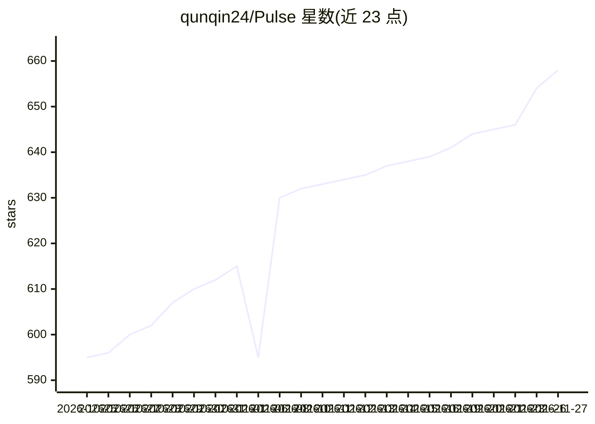

# qunqin24/Pulse

⭐ 658 · Swift · Apache-2.0 · 推送 2026-11-26 · [GitHub](https://github.com/qunqin24/Pulse) · [官网](https://github.com/qunqin24/Pulse/releases/latest) · 个人维护 · 中文 README

**屏幕边缘监控 78 种 AI 编码工具用量配额的 macOS 应用**

运行在屏幕边缘或菜单栏的原生 macOS 应用（Swift/SwiftUI），以环形图标显示 78 个 AI 编码服务的用量限额与重置时间。数据从各服务自身的用量端点、编辑器登录或本地语言服务器读取，密钥加密存于本地，无独立账号与服务器。提供用量速率预测、通知、token 花费统计与多语言界面。要求 macOS 14+；通过 dmg 安装包分发，也可从源码构建（需完整 Xcode 与 macOS 26 SDK）。

## 筛选速览

| 维度 | 判定 | 备注 |
|---|---|---|
| AI 角色 | `ai-ecosystem` | LLM/agent 周边工具 |
| 许可风险 | `permissive` | Apache-2.0 |
| 部署形态 | `desktop` | 安装包/桌面程序 |
| 模型依赖 | — | README 未给出锁定关系 |
| 硬件要求 | — | 无带数字的原话,不猜 |
| 安装摩擦 | `low` | 无编译、无系统依赖或容器化 |
| 成熟度 | — | 结构信号不足 |

## 能力要点

- 78 个服务的用量限额以环形图标显示，颜色随用量变化
- 无独立账号/服务器，复用已有登录，数据不出本机
- 速率预测（burn-rate forecast）与限额通知
- token 花费按 API 公开价折算，支持多币种

## 适用场景

- 同时使用多个 AI 编码订阅时随时查看剩余额度
- 用量接近上限或服务故障时收到通知
- 统计本机各 AI 客户端的 token 花费与使用回顾

## 场景标签

 · 领域:开发者工具/AI 工具监控

## 证据(README 行号)

> L5:  Know how much Claude Code, Codex and Cursor you have left — without opening a single usage page.
> L23: - **Seventy-eight services at a glance** — Claude Code, Codex, Cursor, GitHub Copilot, Antigravity, Kiro, Grok, Dee
> L96: 78 services, each read the way the product itself works — its own usage endpoint, the editor's login, a local langu

## 星数曲线

2026-10-25 595 → 2026-11-27 658（+63）

---
*卡片 v1 · prompt 1.4 · 生成 2026-11-27 · 置信度 high · 依据 README sha `1f7ac2ac6d2c` · [字段定义](../../DATASET.md)*
