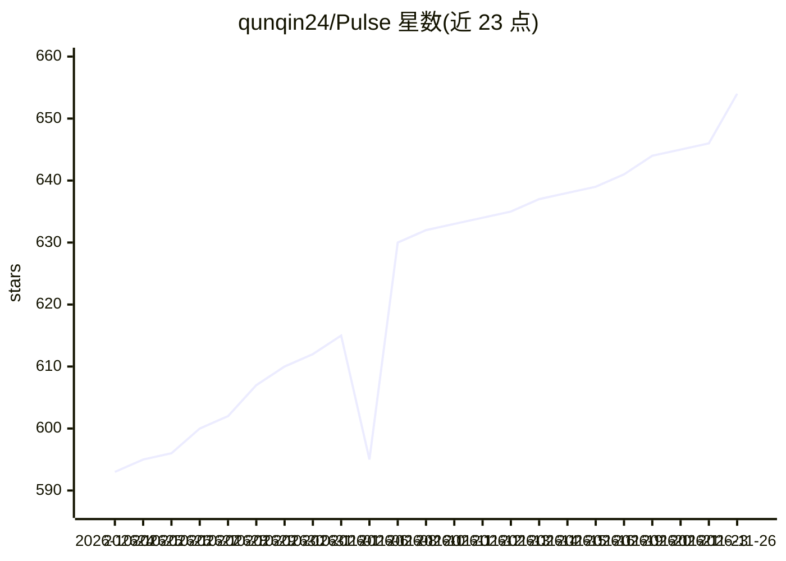

# qunqin24/Pulse

⭐ 654 · Swift · Apache-2.0 · 推送 2026-11-25 · [GitHub](https://github.com/qunqin24/Pulse) · [官网](https://github.com/qunqin24/Pulse/releases/latest) · 个人维护 · 中文 README

**监测 78 个 AI 编程工具用量配额的 macOS 屏边悬浮监控**

一款开源 macOS 菜单栏/屏边悬浮监控工具，读取本机已登录的 AI 编程服务用量数据，以圆环展示各服务的用量与重置时间。覆盖 78 个服务（Claude Code、Codex、Cursor、GitHub Copilot、Kimi Code 等），数据来自各服务自身的用量端点或本地语言服务器，不设自有账号或服务器。提供烧速预测、Token 花费统计（按公共 API 费率折算）、服务状态通知与连接诊断。以 dmg 安装包分发，也可用 Xcode 从源码构建，需 macOS 14+。

## 筛选速览

| 维度 | 判定 | 备注 |
|---|---|---|
| AI 角色 | `ai-ecosystem` | LLM/agent 周边工具 |
| 许可风险 | `permissive` | Apache-2.0 |
| 部署形态 | `desktop` | 安装包/桌面程序 |
| 模型依赖 | locked-api |  |
| 硬件要求 | — | 无带数字的原话,不猜 |
| 安装摩擦 | `low` | 无编译、无系统依赖或容器化 |
| 成熟度 | — | 结构信号不足 |

## 能力要点

- 78 个 AI 编程服务的用量圆环，数据为服务方自报数值
- 无自有账号/服务器，密钥本机加密存储
- 烧速预测与多币种 Token 花费统计（54 个本地客户端）
- 支持屏幕四边停靠、菜单栏模式、`Pulse --json` 脚本接口

## 适用场景

- 同时使用多个 AI 编程订阅时查看各服务剩余额度
- 在触发限额前收到通知
- 统计本地 AI 编码工具的 Token 花费与使用报告

## 场景标签

 · 领域:开发者工具/用量监控

## 证据(README 行号)

> L6:  A free, open-source macOS monitor that sits on the edge of your screen and shows every AI coding limit at a glance.
> L23: - **Seventy-eight services at a glance** — Claude Code, Codex, Cursor, GitHub Copilot, Antigravity, Kiro, Grok, Dee
> L96: 78 services, each read the way the product itself works — its own usage endpoint, the editor's login, a local langu

## 星数曲线

2026-10-24 593 → 2026-11-26 654（+61）

---
*卡片 v1 · prompt 1.4 · 生成 2026-11-26 · 置信度 high · 依据 README sha `c4947effac61` · [字段定义](../../DATASET.md)*
