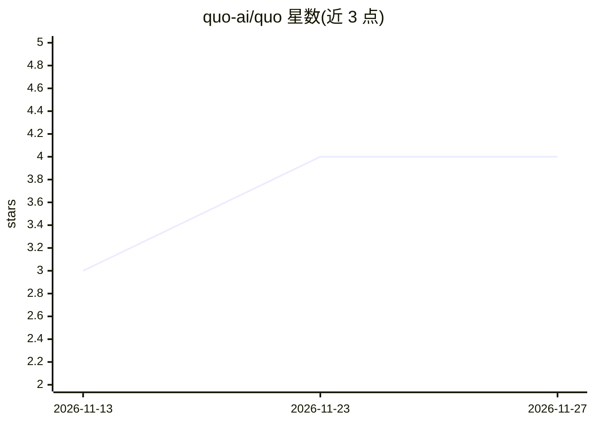

# quo-ai/quo

⭐ 4 · TypeScript · Apache-2.0 · 推送 2026-11-25 · [GitHub](https://github.com/quo-ai/quo) · [官网](https://quo.computer) · 组织维护

**在本地设备离线运行的私有 AI 应用，提供聊天、编码代理与图片生成**

一个跨设备（浏览器、桌面、手机）的本地 AI 应用：用开放模型在用户自己的设备上运行聊天、文档问答、照片理解、图片生成与带审批机制的代码代理，离线可用，数据不出设备。运行时基于 llama.cpp 生态（wllama/WebAssembly、桌面 llama.cpp、手机 llama.rn），可从 Hugging Face 搜索并运行 GGUF 模型，并按设备硬件推荐适配模型。云模型、高级同步与部分手机功能为付费项。

## 筛选速览

| 维度 | 判定 | 备注 |
|---|---|---|
| AI 角色 | `ai-native` | 本体是模型或模型工具 |
| 许可风险 | `permissive` | Apache-2.0 |
| 部署形态 | `library` | 以包/库形式分发 |
| 模型依赖 | local-ok | 支持本地模型 |
| 硬件要求 | — | 无带数字的原话,不猜 |
| 安装摩擦 | `low` | 无编译、无系统依赖或容器化 |
| 成熟度 | — | 结构信号不足 |

## 能力要点

- 离线运行开放模型（Qwen、Gemma、Llama、Phi、Mistral），聊天/代码/图片均在本机完成
- Code mode 编码代理：每次编辑、命令、commit、push 均需用户批准
- 浏览器端 wllama（llama.cpp WebAssembly）、桌面 llama.cpp、手机 llama.rn 三套运行时
- 可搜索 Hugging Face 运行 GGUF 模型，下载前检查内存是否够用

## 适用场景

- 无网络环境下在本地设备使用 AI 聊天与文档问答
- 用本地模型让编码代理改代码并逐项审批变更
- 在手机上离线运行小型开放模型

## 场景标签

`AI 助手` `聊天机器人` `编码 Agent` `文档问答` · 领域:编码与开发

## 证据(README 行号)

> L5: **Private AI that runs on your own computer, browser and phone. It works offline.**
> L7: Chat, write code, read documents and make pictures with open models, on your own device.
> L34: - **Chat with no internet.** Open models (Qwen, Gemma, Llama, Phi, Mistral) run on your graphics card or processor.

## 星数曲线

2026-11-13 3 → 2026-11-27 4（+1）

---
*卡片 v1 · prompt 1.4 · 生成 2026-11-21 · 置信度 high · 依据 README sha `696d1f4c6e02` · [字段定义](../../DATASET.md)*
