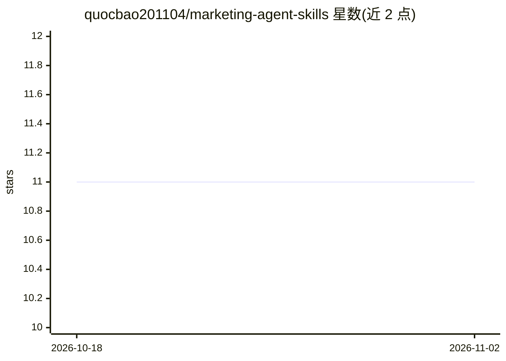

# quocbao201104/marketing-agent-skills

⭐ 11 · Python · MIT · 推送 2026-10-13 · [GitHub](https://github.com/quocbao201104/marketing-agent-skills) · 个人维护

**给 AI agent 安装的营销技能包：客户研究到文案执行**

以 Agent Skill 形式发布的可复用营销技能包，供市场营销人员、创始人、研究员与内容团队在 Claude、ChatGPT、Codex 等 host 中使用。核心是 SKILL.md 运行时契约与配套知识库：将客户访谈整理为有据综合、比较定位选项、基于已采纳策略写文案、诊断投放表现变化，约束声明须有证据支撑，区分观察/解释/假设/决策。识别 WRITE、DECIDE、DIAGNOSE 等 7 类运行时任务，按需加载知识。限制：技能本身不提供工具或外部权限，产出依赖 host 的模型与能力。

## 筛选速览

| 维度 | 判定 | 备注 |
|---|---|---|
| AI 角色 | `ai-knowledge` | 知识聚合/清单类 |
| 许可风险 | `permissive` | MIT |
| 部署形态 | `library` | 以包/库形式分发 |
| 模型依赖 | — | README 未给出锁定关系 |
| 硬件要求 | — | 无带数字的原话,不猜 |
| 安装摩擦 | `low` | 无编译、无系统依赖或容器化 |
| 成熟度 | — | 结构信号不足 |

## 能力要点

- 覆盖客户研究、定位、文案、投放诊断、测试学习的技能包
- 以 SKILL.md 为运行时契约，识别 7 类运行时任务（WRITE/DECIDE/DIAGNOSE 等）
- 约束声明不得超出所提供证据，区分观察/解释/假设/决策等概念
- 支持 Claude/Codex 桌面端、CLI（npx skills add）与 ChatGPT 网页端安装

## 适用场景

- 让 AI 助手把客户访谈整理成有证据支撑的需求综合
- 在已采纳的定位策略基础上生成落地页与邮件文案
- 投放数据变化时先做诊断再决定干预措施

## 场景标签

`AI 写作` · 领域:内容生成

## 证据(README 行号)

> L5: A reusable marketing skill for people working with AI: research customers, shape strategy, create content, and inter
> L10: Format: Agent Skill
> L99: The governing runtime contract is `skills/marketing-agent-skills/SKILL.md`. Its compact decision table gives direct

## 星数曲线

2026-10-18 11 → 2026-11-02 11（+0）

---
*卡片 v1 · prompt 1.4 · 生成 2026-11-01 · 置信度 high · 依据 README sha `8225d9d19cf2` · [字段定义](../../DATASET.md)*
