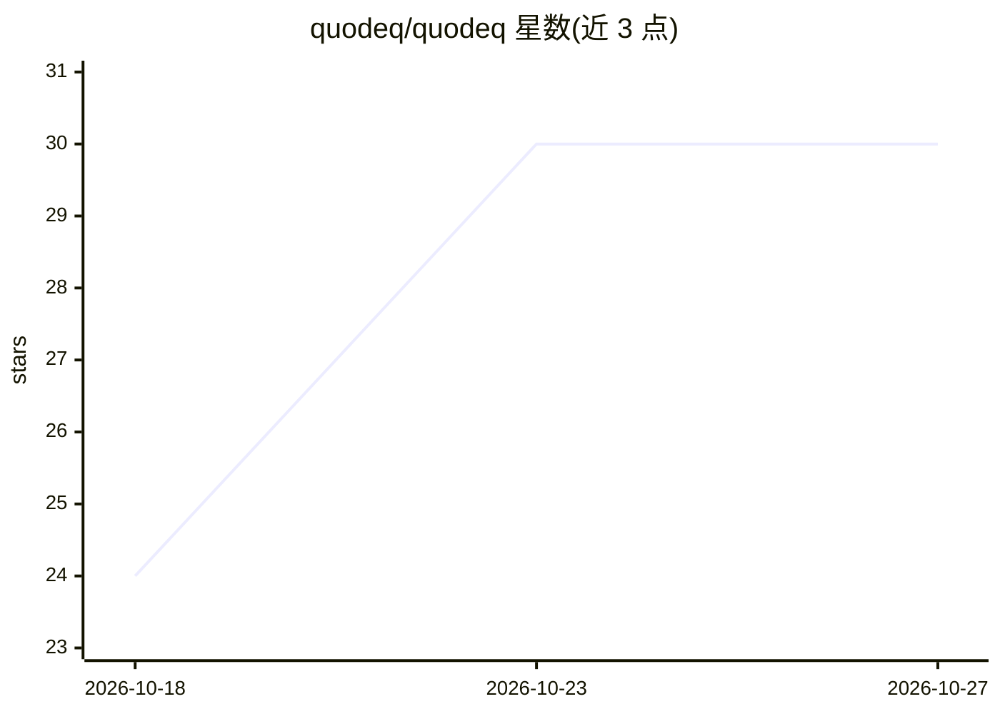

# quodeq/quodeq

⭐ 30 · Python · MIT · 推送 2026-10-24 · [GitHub](https://github.com/quodeq/quodeq) · [官网](https://quodeq.ai) · 组织维护

**本地运行的开源代码质量与安全扫描器，用自选 AI 模型审查代码**

基于 Python 的代码审查工具：用户选择 AI 模型（Claude Code、Codex、Gemini CLI、GitHub Copilot、OpenRouter，或经 Ollama/llama.cpp/omlx 的本地模型）对代码库做质量与安全扫描。默认依据 ISO 25010 的六个质量维度打分（每项 0-10），每条发现给出违反规则、文件行号、原因与修复计划，并标注 CWE 编号；支持自定义团队规范、仪表盘、PR/CI 集成与 SARIF 上传。MIT 许可，本地运行，无账号、无遥测；要求 Python 3.12+。

## 筛选速览

| 维度 | 判定 | 备注 |
|---|---|---|
| AI 角色 | `ai-native` | 本体是模型或模型工具 |
| 许可风险 | `permissive` | MIT |
| 部署形态 | `library` | 以包/库形式分发 |
| 模型依赖 | local-ok | 支持本地模型 |
| 硬件要求 | — | 无带数字的原话,不猜 |
| 安装摩擦 | `low` | 无编译、无系统依赖或容器化 |
| 成熟度 | `idea` | |

## 能力要点

- 按 ISO 25010 六维度 0-10 打分，每条发现含规则、位置、原因与修复计划
- 支持 OpenRouter、各 AI CLI 及 Ollama/llama.cpp/omlx 本地模型
- 可自定义团队规范并同等参与评分，预置 Clean Architecture、DDD、无障碍规范
- PR 审查、CI 流水线与 SARIF 上传到 code scanning

## 适用场景

- 给项目代码做安全与质量扫描并获得评分
- 在 CI 中审查 PR 并上报发现
- 用本地模型在代码不出机的前提下完成审查

## 场景标签

`代码审查` `网络安全` · 领域:编码与开发

## 证据(README 行号)

> L12: Quodeq reviews a codebase with the AI model you choose, against standards you can read and change: the six quality 
> L33: 2. **Have a model at hand.** quodeq works with an AI CLI you already use (Claude Code, Codex, Gemini CLI, GitHub Co

## 星数曲线

2026-10-18 24 → 2026-10-27 30（+6）

---
*卡片 v1 · prompt 1.4 · 生成 2026-10-26 · 置信度 high · 依据 README sha `5d4d0dc6f877` · [字段定义](../../DATASET.md)*
