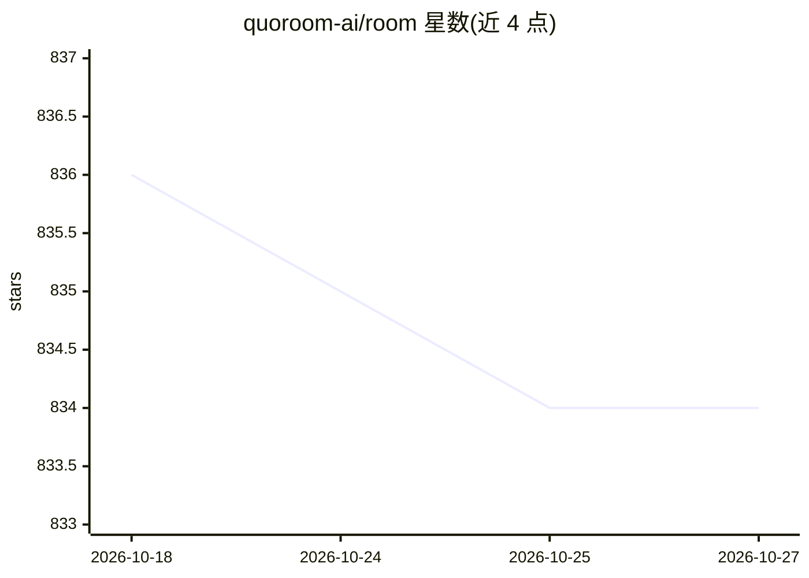

# quoroom-ai/room

⭐ 834 · TypeScript · MIT · 推送 2026-04-12 · [GitHub](https://github.com/quoroom-ai/room) · [官网](https://quoroom.ai) · 组织维护

**自主多智能体集群引擎：本地运行 Queen/Worker/投票治理**

开源研究项目 Quoroom 的引擎仓库，实现自主 agent 集群（Room）：Queen 负责策略，Workers 执行任务，Quorum 由 agent 投票决策，Keeper（人类）设定目标并管理钱包。提供层级目标分解、可复用技能、带审计回滚的自我修改、向量记忆、EVM 多链钱包、cron/webhook 任务调度、MCP server、REST API、React 仪表盘与 CLI。模型接入支持本地 Ollama（一键装 qwen3-coder:30b）、Claude Code/Codex CLI 及 OpenAI/Claude/Gemini API。数据默认本地存储，另有 quoroom.io 云模式。

## 筛选速览

| 维度 | 判定 | 备注 |
|---|---|---|
| AI 角色 | `ai-ecosystem` | LLM/agent 周边工具 |
| 许可风险 | `permissive` | MIT |
| 部署形态 | `desktop` | 安装包/桌面程序 |
| 模型依赖 | local-ok | 支持本地模型 |
| 硬件要求 | — | 无带数字的原话,不猜 |
| 安装摩擦 | `low` | 无编译、无系统依赖或容器化 |
| 成熟度 | `idea` | |

## 能力要点

- Queen/Workers/Quorum 投票治理的自主 agent 集群架构
- 一键安装本地 Ollama 模型（qwen3-coder:30b），本地路径无付费回退
- MCP server 自动注册到已装的 AI 编码工具（Claude Code/Codex/Cursor/Windsurf）
- 自我修改带审计与一键回滚；EVM 多链钱包与链上身份

## 适用场景

- 在本地机器上运行持续自主执行目标的 AI agent 集群
- 通过仪表盘或 API 管理 agent 房间、目标与任务
- 用 webhook/GitHub push 等外部事件触发 agent 任务

## 场景标签

`多智能体` · 领域:Agent 开发

## 证据(README 行号)

> L57: - **Queen** — strategic brain, supports free local (`ollama:qwen3-coder:30b`), Claude Code CLI, Codex CLI, and Open
> L64: `quoroom-ai/room` is the engine: agent loop, quorum governance, goals, skills, self-modification, wallet, memory, t
> L191: On first run, `quoroom serve` automatically registers the Quoroom MCP server in every AI coding tool you have inst

## 星数曲线

2026-10-18 836 → 2026-10-27 834（-2）

---
*卡片 v1 · prompt 1.4 · 生成 2026-10-21 · 置信度 mid · 依据 README sha `ea5e808c820a` · [字段定义](../../DATASET.md)*
