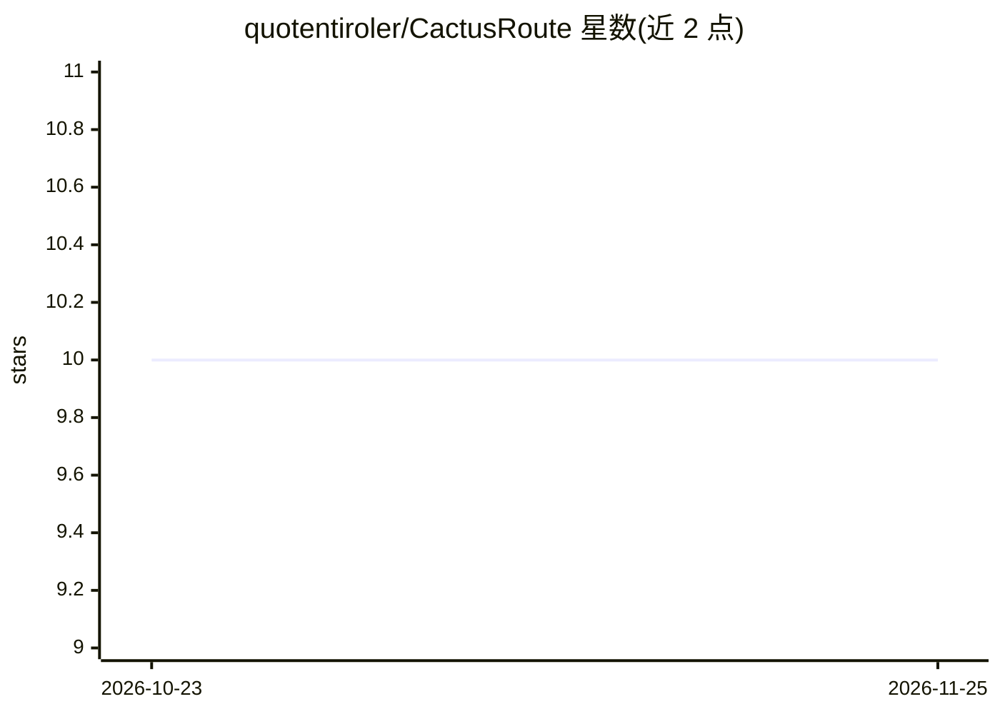

# quotentiroler/CactusRoute

⭐ 10 · Python · 推送 2026-11-13 · [GitHub](https://github.com/quotentiroler/CactusRoute) · 个人维护

**端云混合函数调用路由框架：本地小模型优先、云端兜底**

面向 FunctionGemma Hackathon 的混合推理策略项目：在 270M 端侧模型（FunctionGemma，经 Cactus 运行）与云端 Gemini 2.5 Flash 之间按 7 层自适应框架路由工具调用查询，包含难度估计、交接信号、输出修复、多门验证、按难度阈值、变体重试与确定性抽取，各层引用 arXiv 论文作为依据。测试可在任意平台运行，基准与演示仅限装有 Cactus SDK 的 Mac，云端调用需 GEMINI_API_KEY。项目定位为黑客松参赛作品，许可条款指向上游仓库。

## 筛选速览

| 维度 | 判定 | 备注 |
|---|---|---|
| AI 角色 | `ai-ecosystem` | LLM/agent 周边工具 |
| 许可风险 | `none` | — |
| 部署形态 | `None` |  |
| 模型依赖 | — | README 未给出锁定关系 |
| 硬件要求 | — | 无带数字的原话,不猜 |
| 安装摩擦 | `low` | 无编译、无系统依赖或容器化 |
| 成熟度 | — | 结构信号不足 |

## 能力要点

- 7 层自适应路由：难度估计、自适应阈值（0.25/0.45/0.60）、交接信号与云端兜底
- 11 个语义角色映射正则抽取策略，支持无模型调用的确定性提取
- 输出修复与多门验证（结构/语义/意图覆盖）及变体提示词重试
- 239 项测试可在无 Cactus 与 API key 的平台上运行

## 适用场景

- 端侧小模型优先处理工具调用、降低云端调用比例
- 为函数调用场景搭建多级验证与输出修复流水线
- 在设备端与云端模型之间按查询难度动态分配任务

## 场景标签

`模型网关` · 领域:Agent 开发

## 证据(README 行号)

> L10: A hybrid inference strategy for the FunctionGemma Hackathon that dynamically routes tool-calling queries between a 
> L12: Instead of using a fixed confidence threshold (the baseline uses 0.99, routing nearly everything to cloud), CactusR

## 星数曲线

2026-10-23 10 → 2026-11-25 10（+0）

---
*卡片 v1 · prompt 1.4 · 生成 2026-11-19 · 置信度 mid · 依据 README sha `7c123b7dcd01` · [字段定义](../../DATASET.md)*
