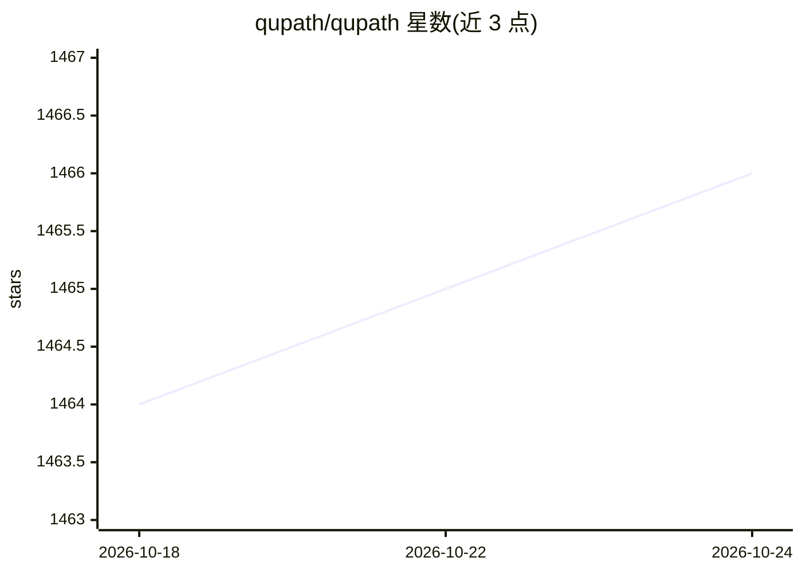

# qupath/qupath

⭐ 1,466 · Java · GPL-3.0 · 推送 2026-10-21 · [GitHub](https://github.com/qupath/qupath) · [官网](https://qupath.github.io) · 组织维护

**开源生物图像分析软件：标注、分割与机器学习分类**

面向科研的开源生物图像分析桌面软件，支持全切片与显微镜图像的标注和查看，提供明场与荧光图像分析工作流、细胞分割、组织微阵列去阵列等算法，以及交互式机器学习做对象与像素分类；支持脚本化定制、批处理，并可与 ImageJ 等工具集成。由爱丁堡大学团队开发，GPLv3 许可，声明仅用于研究用途，发表工作需引用其论文。

## 筛选速览

| 维度 | 判定 | 备注 |
|---|---|---|
| AI 角色 | `ai-native` | 本体是模型或模型工具 |
| 许可风险 | `viral` | GPL-3.0 |
| 部署形态 | `desktop` | 安装包/桌面程序 |
| 模型依赖 | — | README 未给出锁定关系 |
| 硬件要求 | — | 无带数字的原话,不猜 |
| 安装摩擦 | `low` | 无编译、无系统依赖或容器化 |
| 成熟度 | — | 结构信号不足 |

## 能力要点

- 全切片与显微镜图像的标注与查看工具
- 细胞分割与组织微阵列去阵列算法
- 交互式机器学习的对象与像素分类
- 脚本化定制、批处理与 ImageJ 集成

## 适用场景

- 对全切片病理图像做标注与细胞分割
- 用机器学习对图像中的对象和像素做分类
- 批量处理显微图像并导出分析结果

## 场景标签

`科研工具` `图像视频处理` `目标检测` · 领域:学习与行业

## 证据(README 行号)

> L9: **QuPath is open source software for bioimage analysis**.
> L16: * Interactive machine learning for object & pixel classification

## 星数曲线

2026-10-18 1,464 → 2026-10-24 1,466（+2）

---
*卡片 v1 · prompt 1.4 · 生成 2026-10-21 · 置信度 high · 依据 README sha `9d61f81589c1` · [字段定义](../../DATASET.md)*
