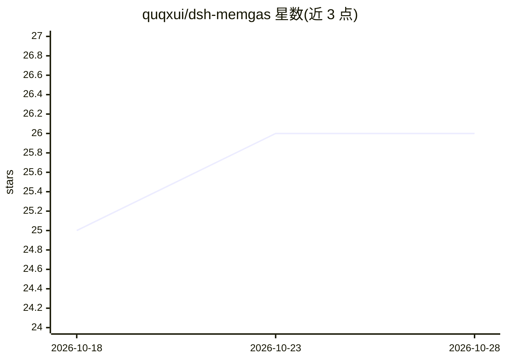

# quqxui/dsh-memgas

⭐ 26 · TypeScript · MIT · 推送 2026-09-29 · [GitHub](https://github.com/quqxui/dsh-memgas) · 个人维护 · 中文 README

**给 DeepSeek Harness 代理的长期记忆插件，跨会话记忆四通道检索**

面向 DeepSeek Harness (dsh) 的长期记忆插件：每轮对话后台提取事实、摘要与关键词入库存于本地 SQLite；检索并行运行词法（FTS5）、稠密向量、多粒度与图（PageRank）四个通道并用 Reciprocal Rank Fusion 融合。记忆由六个后台进程持续演化（关联、合并、强化、衰减、抽象、重关联）。复用 dsh 已配置的模型，无额外 API key；带降级机制与诊断命令。已知限制：本地 embedding 模型未用真实权重验证、memgas-mcp 未接入真实 MCP 客户端。

## 筛选速览

| 维度 | 判定 | 备注 |
|---|---|---|
| AI 角色 | `ai-ecosystem` | LLM/agent 周边工具 |
| 许可风险 | `permissive` | MIT |
| 部署形态 | `library` | 以包/库形式分发 |
| 模型依赖 | — | README 未给出锁定关系 |
| 硬件要求 | — | 无带数字的原话,不猜 |
| 安装摩擦 | `low` | 无编译、无系统依赖或容器化 |
| 成熟度 | — | 结构信号不足 |

## 能力要点

- 四通道检索（FTS5/向量/多粒度/图）经 RRF 融合，基线通道保留至少半数席位
- 六个后台记忆演化进程，均不阻塞对话关键路径
- 基于 MemGAS（ICLR 2026）方法构建
- memgas-mcp 可让 Claude Code、Codex 等 agent 共享同一记忆库

## 适用场景

- 让编程代理跨会话记住项目约定、决策与踩坑记录
- 通过 /memory 命令查看、检索与诊断记忆库
- 多个 agent 客户端经 MCP 共享同一项目记忆

## 场景标签

`Agent 记忆` · 领域:Agent 开发

## 证据(README 行号)

> L10: **Long-term memory for DeepSeek Harness (dsh).** Your agent remembers this project's conventions, decisions and pit
> L12: Retrieval builds on the multi-granularity association and adaptive selection method from the ICLR 2026 paper *From 
> L150: The source is three packages: `packages/dsh-plugin` (dsh wiring), `memgas-core` (storage, retrieval channels, evol

## 星数曲线

2026-10-18 25 → 2026-10-28 26（+1）

---
*卡片 v1 · prompt 1.4 · 生成 2026-10-27 · 置信度 high · 依据 README sha `f54e38a4e853` · [字段定义](../../DATASET.md)*
