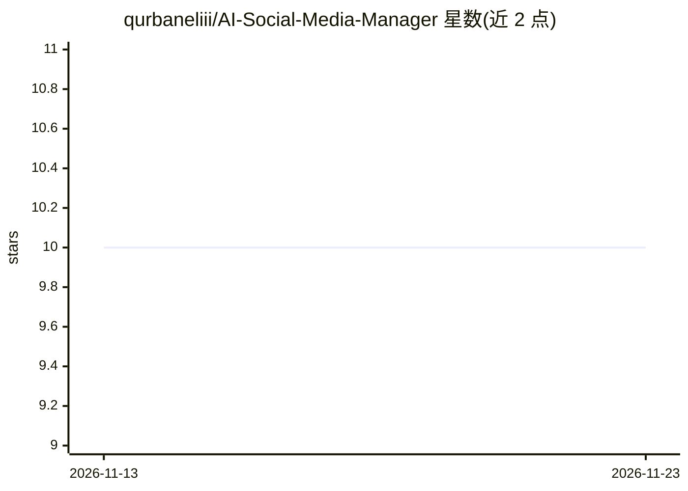

# qurbaneliii/AI-Social-Media-Manager

⭐ 10 · Python · Apache-2.0 · 推送 2026-07-13 · [GitHub](https://github.com/qurbaneliii/AI-Social-Media-Manager) · [官网](https://qurbaneliii.github.io/AI-Social-Media-Manager/) · 个人维护

**AI 社媒内容运营工作台：按品牌规则生成与排期多平台内容**

产品形态的全栈原型应用 ARIA：Next.js 前端 + FastAPI 的 llm-orchestration 后端，覆盖内容生成的主题/平台/草稿/审核/排期流程。生成由品牌规则（Brand Brain）、审批队列与确定性工作流约束；支持 LinkedIn、X、Instagram、TikTok 等 6 个平台的差异化文案，以及标签/SEO、视觉理解、受众定向等服务模块。本地基础设施经 Docker Compose 启动 Postgres、Redis、Kafka、Temporal。项目自述为 MVP/原型，未完成端到端部署验证，不含真实平台发布凭证。

## 筛选速览

| 维度 | 判定 | 备注 |
|---|---|---|
| AI 角色 | `ai-native` | 本体是模型或模型工具 |
| 许可风险 | `permissive` | Apache-2.0 |
| 部署形态 | `self-host` | docker 或自建部署 |
| 模型依赖 | — | README 未给出锁定关系 |
| 硬件要求 | — | 无带数字的原话,不猜 |
| 安装摩擦 | `low` | 无编译、无系统依赖或容器化 |
| 成熟度 | — | 结构信号不足 |

## 能力要点

- 品牌规则约束的多平台内容生成工作流（含审批队列）
- llm-orchestration FastAPI 网关统一接入，支持 mock 模式
- Docker Compose 一键启动 Postgres/Redis/Kafka/Temporal 本地基础设施
- 排期与时间优化、hashtag/SEO、视觉理解等服务模块

## 适用场景

- 团队统一管理多平台社媒文案的策划、审核与排期
- 用品牌词表和 CTA 策略约束 AI 生成的营销内容
- 搭建内容运营类的全栈原型做二次开发

## 场景标签

`AI 写作` · 领域:内容生成

## 证据(README 行号)

> L7: AI Social Media Manager, also referred to as ARIA in the codebase, is a product-style AI application for content ope
> L18: - Brand-aware AI generation through the canonical llm-orchestration backend, with explicit mock mode
> L32: |AI / LLM|Python llm-orchestration gateway, backend-only OpenAI-compatible provider configuration, explicit mock mo

## 星数曲线

2026-11-13 10 → 2026-11-23 10（+0）

---
*卡片 v1 · prompt 1.4 · 生成 2026-11-19 · 置信度 high · 依据 README sha `1cc7c2451a89` · [字段定义](../../DATASET.md)*
