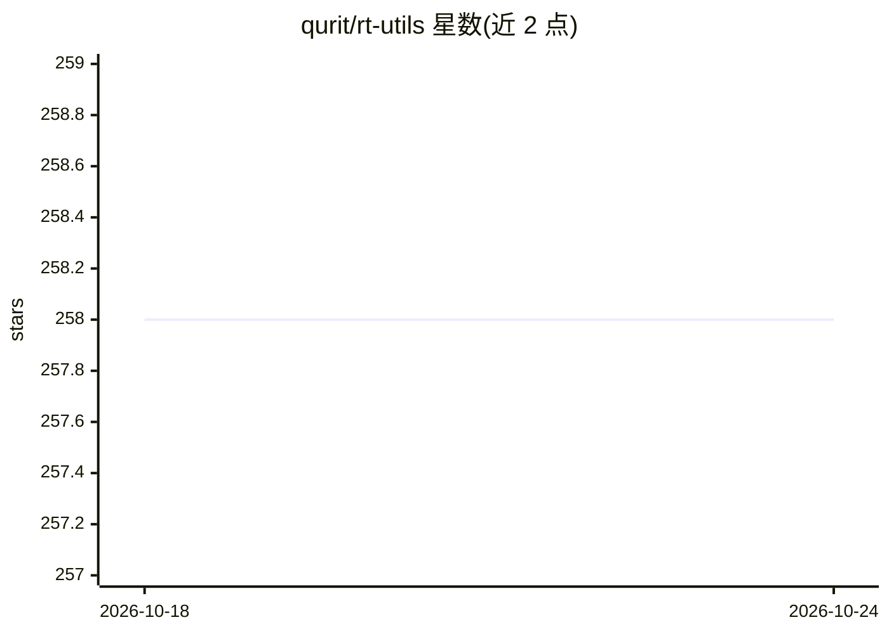

# qurit/rt-utils

⭐ 258 · Python · MIT · 推送 2026-09-30 · [GitHub](https://github.com/qurit/rt-utils) · 组织维护

**DICOM RTStruct 创建与操作的 Python 库，供查看分割结果**

面向医生与医学影像开发者的轻量库：通过 builder 类创建或加载 RT Struct，以布尔型 3D numpy 掩码添加 ROI（可指定颜色/名称/轮廓模式），从 ROIs 提取 3D 掩码，合并两个 RT Struct 并保存。掩码可来自 ML 分割模型输出。限制：仅支持单一 frame of reference UID 与 structured set ROI sequence，ROI 内空洞可能处理不佳。libGL 为必需系统依赖。

## 筛选速览

| 维度 | 判定 | 备注 |
|---|---|---|
| AI 角色 | `ai-enhanced` | 去掉 AI 部分产品仍成立 |
| 许可风险 | `permissive` | MIT |
| 部署形态 | `library` | 以包/库形式分发 |
| 模型依赖 | — | README 未给出锁定关系 |
| 硬件要求 | — | 无带数字的原话,不猜 |
| 安装摩擦 | `low` | 无编译、无系统依赖或容器化 |
| 成熟度 | — | 结构信号不足 |

## 能力要点

- 以 3D 布尔 numpy 掩码添加/提取 ROI，含轮廓模式选项
- 合并两个已有 RT Struct 为一个文件
- RTStructBuilder 创建与加载，数行代码完成保存

## 适用场景

- 将 ML 分割模型的掩码结果写入 RT Struct 供医生查看
- 从现有 RT Struct 提取 ROI 三维掩码进行可视化
- 合并多个 RT Struct 文件

## 场景标签

`图像视频处理` · 领域:感知与多模态

## 证据(README 行号)

> L9: RT-Utils is motivated to allow physicians and other users to view the results of segmentation performed on a series 
> L43: # Create mask through means such as ML

## 星数曲线

2026-10-18 258 → 2026-10-24 258（+0）

---
*卡片 v1 · prompt 1.4 · 生成 2026-10-22 · 置信度 high · 依据 README sha `fb230a3f0e2e` · [字段定义](../../DATASET.md)*
