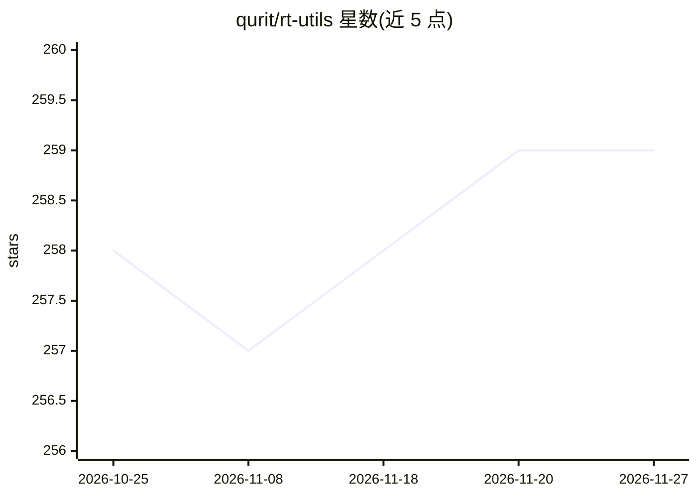

# qurit/rt-utils

⭐ 259 · Python · MIT · 推送 2026-11-15 · [GitHub](https://github.com/qurit/rt-utils) · 组织维护

**放疗科研人员读写 DICOM RTStruct 与掩膜互转的 Python 库**

读取与写入 DICOM RT Structure Set：将 RTStruct 转为 NumPy 掩膜以便计算，也能将分割模型产出的掩膜写回符合规范的 RTStruct 供计划系统或查看器打开。支持 NIfTI 转换（需可选依赖 SimpleITK）、按坐标生成轮廓、内存中处理 pydicom 数据、ROI 颜色与名称管理、掩膜平滑与结构集合合并，可读取单文件重建的 SPECT/增强 CT/MR/PET 序列。提供 pip 安装与 readthedocs 文档，有 JOSS 论文与引用格式。

## 筛选速览

| 维度 | 判定 | 备注 |
|---|---|---|
| AI 角色 | `ai-enhanced` | 去掉 AI 部分产品仍成立 |
| 许可风险 | `permissive` | MIT |
| 部署形态 | `library` | 以包/库形式分发 |
| 模型依赖 | — | README 未给出锁定关系 |
| 硬件要求 | — | 无带数字的原话,不猜 |
| 安装摩擦 | `low` | 无编译、无系统依赖或容器化 |
| 成熟度 | — | 结构信号不足 |

## 能力要点

- RTStruct ↔ NumPy 掩膜双向转换，掩膜轴序与 pydicom pixel_array 一致
- NIfTI 分割结果对齐到序列网格（可选 extra 安装 SimpleITK）
- 内存内处理：pydicom 数据集进出，输出 BytesIO
- ROI 管理：颜色、名称、删除与 RTROIInterpretedType 标注

## 适用场景

- 把分割模型的输出掩膜导出为放疗计划系统可打开的 RTStruct
- 把已有 RTStruct 读取为掩膜做数值计算
- 合并同一序列上多次勾画的结构集合
- 在 PET/SPECT 重建影像上处理 ROI

## 场景标签

`科研工具` `图像视频处理` · 领域:学习与行业

## 证据(README 行号)

> L10: RT-Utils reads and writes the DICOM **RT Structure Set**, the file a treatment planning system stores contoured ana
> L35:  An ROI written from a liver segmentation model, as viewed in Slicer. (The underlying patient data has been hidden.

## 星数曲线

2026-10-25 258 → 2026-11-27 259（+1）

---
*卡片 v1 · prompt 1.4 · 生成 2026-11-25 · 置信度 high · 依据 README sha `5988663bca26` · [字段定义](../../DATASET.md)*
