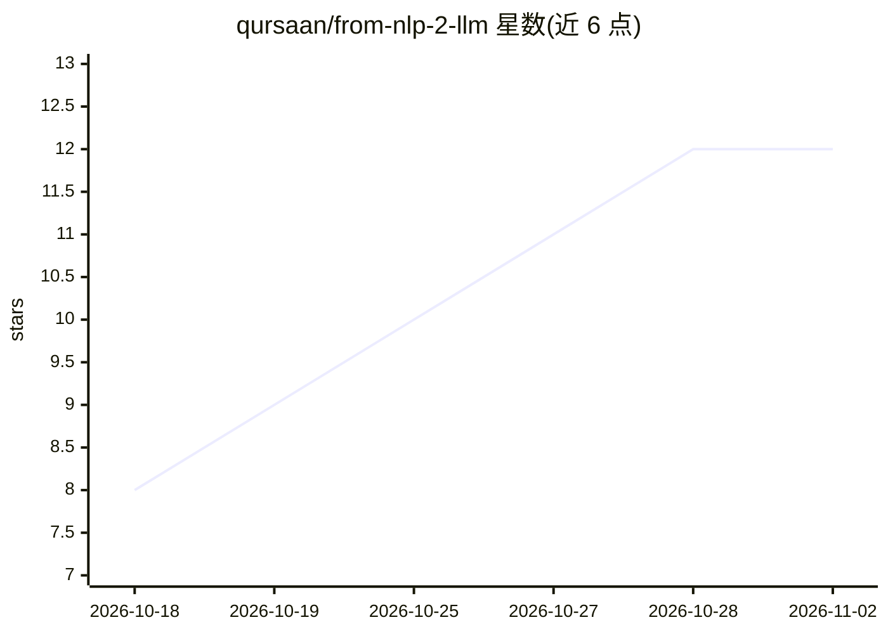

# qursaan/from-nlp-2-llm

⭐ 12 · 推送 2026-10-30 · [GitHub](https://github.com/qursaan/from-nlp-2-llm) · [官网](https://web.qursaan.com/#/course/nlp) · 个人维护

**《From NLP to LLM》教材的学生配套资料仓库**

Mahmmoud A. Mahdi 所著《From NLP to LLM: The Evolution of Language Intelligence》的教辅材料合集，含书籍 PDF（分章发布的草稿版）、学生练习册、实验手册、章节可运行示例代码、技能实验起点以及 Sanad 项目的分级 checkpoint（L1 规则基线、L2 规则与槽位、L3 语料统计与容错检索）。面向跟书学习的学生：每章配工作表与项目关卡，实验涉及阿拉伯语语料（corpus_ar.txt）。Sanad 起点需 Python 3.11+，通过 venv 与 pip 安装依赖并用 pytest 运行。

## 筛选速览

| 维度 | 判定 | 备注 |
|---|---|---|
| AI 角色 | `ai-knowledge` | 知识聚合/清单类 |
| 许可风险 | `none` | — |
| 部署形态 | `library` | 以包/库形式分发 |
| 模型依赖 | — | README 未给出锁定关系 |
| 硬件要求 | — | 无带数字的原话,不猜 |
| 安装摩擦 | `low` | 无编译、无系统依赖或容器化 |
| 成熟度 | — | 结构信号不足 |

## 能力要点

- 含书籍、练习册、实验手册三份 PDF 与分章可运行示例
- Sanad 项目按章节分级提供 checkpoint（L1–L3）
- 实验与语料面向阿拉伯语 NLP
- 需 Python 3.11+，venv + pip 安装，pytest 运行

## 适用场景

- 跟随本书章节学习 NLP 到 LLM 的演进
- 完成练习册工作表并逐级搭建 Sanad 项目
- 运行章节示例核验书中数字

## 场景标签

`教程课程` · 领域:学习与行业

## 证据(README 行号)

> L3: Everything you need to study with **From NLP to LLM: The Evolution of Language
> L4: Intelligence** by Mahmmoud A. Mahdi: the book, the student workbook, the lab
> L5: manual, the chapter examples, the skill-lab starters, and the Sanad project

## 星数曲线

2026-10-18 8 → 2026-11-02 12（+4）

---
*卡片 v1 · prompt 1.4 · 生成 2026-11-01 · 置信度 high · 依据 README sha `ac1be1e13b04` · [字段定义](../../DATASET.md)*
