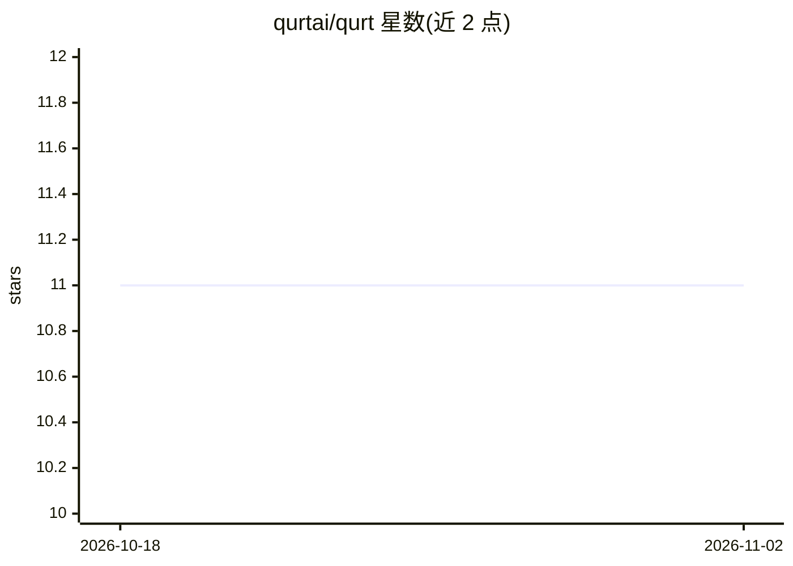

# qurtai/qurt

⭐ 11 · TypeScript · MIT · 推送 2026-03-06 · [GitHub](https://github.com/qurtai/qurt) · [官网](https://qurt.ai) · 个人维护

**自带 API key 的多模型 AI 桌面助手（AI 同事）**

基于 Electron + React + TypeScript 的桌面端 AI 助手应用：用户接入自己的各提供商 API key，选择不同模型进行对话，可在聊天中附带文件与图片。采用本地优先方式存储密钥与聊天上下文。提供 GitHub Releases 安装包（Windows/macOS）与源码运行（npm install / npm run dev）两种途径，发布流程含自动测试、多平台构建与基于 GitHub Release 的自动更新。

## 筛选速览

| 维度 | 判定 | 备注 |
|---|---|---|
| AI 角色 | `ai-native` | 本体是模型或模型工具 |
| 许可风险 | `permissive` | MIT |
| 部署形态 | `library` | 以包/库形式分发 |
| 模型依赖 | — | README 未给出锁定关系 |
| 硬件要求 | — | 无带数字的原话,不猜 |
| 安装摩擦 | `low` | 无编译、无系统依赖或容器化 |
| 成熟度 | — | 结构信号不足 |

## 能力要点

- 自带 API key（bring-your-own-key）的多提供商模型选择
- 聊天中附加文件与图片
- 本地优先存储密钥与聊天上下文
- Electron + React + TypeScript 桌面应用，GitHub Releases 自动更新

## 适用场景

- 在一个桌面应用中使用多个 AI 提供商的模型
- 带文件/图片附件与 AI 对话处理日常工作
- 不愿被单一提供商锁定的个人用户

## 场景标签

`AI 助手` · 领域:对话与助手

## 证据(README 行号)

> L3: AI Coworker and assistant with provider freedom: bring your own API keys, choose your model, and chat with files/ima
> L22: - Bring-your-own-key model access

## 星数曲线

2026-10-18 11 → 2026-11-02 11（+0）

---
*卡片 v1 · prompt 1.4 · 生成 2026-11-01 · 置信度 high · 依据 README sha `072fddd3b0e5` · [字段定义](../../DATASET.md)*
