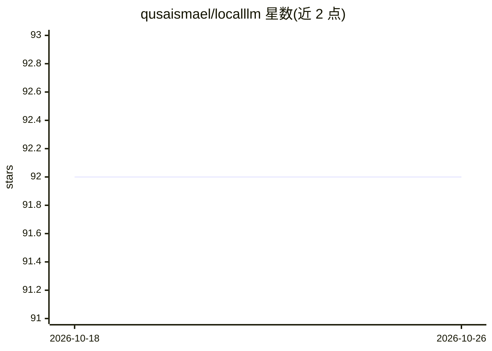

# qusaismael/localllm

⭐ 92 · JavaScript · MIT · 推送 2026-02-05 · [GitHub](https://github.com/qusaismael/localllm) · [官网](https://localllm.qusai.pro) · 个人维护

**通过 Ollama 与本地 LLM 对话的 Web 界面**

基于 Flask 的 Web 应用：连接本地或远程 Ollama 实例，提供与任意 Ollama 模型的聊天界面。聊天历史持久化存储于本地 SQLite，支持跨会话搜索、导出为 Markdown，可在设置中修改 Ollama URL 以连接远程实例。运行需先安装 Ollama 并拉取模型（如 llama3.2），再 pip install flask 后启动 python app.py，访问 localhost:5000 使用。MIT 许可。

## 筛选速览

| 维度 | 判定 | 备注 |
|---|---|---|
| AI 角色 | `ai-native` | 本体是模型或模型工具 |
| 许可风险 | `permissive` | MIT |
| 部署形态 | `library` | 以包/库形式分发 |
| 模型依赖 | local-ok | 支持本地模型 |
| 硬件要求 | — | 无带数字的原话,不猜 |
| 安装摩擦 | `low` | 无编译、无系统依赖或容器化 |
| 成熟度 | — | 结构信号不足 |

## 能力要点

- 通过 Ollama 运行任意本地 LLM 模型
- 聊天历史本地 SQLite 持久化
- 跨会话搜索与导出 Markdown
- 可配置 Ollama URL 连接远程实例

## 适用场景

- 在本地与 LLM 对话且数据不出本机
- 连接自建的远程 Ollama 实例聊天
- 检索和导出历史对话记录

## 场景标签

`聊天机器人` · 领域:对话与助手

## 证据(README 行号)

> L3: A simple web interface for chatting with local LLMs through Ollama.
> L22: - Persistent chat history (stored locally in SQLite)

## 星数曲线

2026-10-18 92 → 2026-10-26 92（+0）

---
*卡片 v1 · prompt 1.4 · 生成 2026-10-23 · 置信度 high · 依据 README sha `183c671072a7` · [字段定义](../../DATASET.md)*
