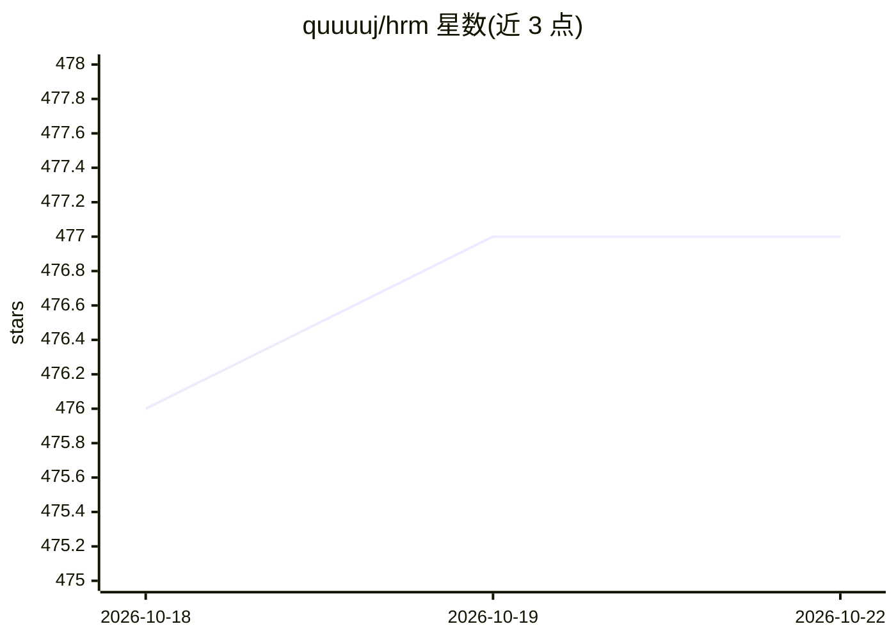

# quuuuj/hrm

⭐ 477 · Java · GPL-3.0 · 推送 2026-10-20 · [GitHub](https://github.com/quuuuj/hrm) · 个人维护 · 中文 README

**企业人力资源管理系统：含 RAG 知识库智能问答**

基于 Spring Boot 3.4 + Vue 2.6 + Element UI 的前后端分离人力资源管理系统，覆盖组织架构、员工档案、RBAC 权限、Flowable 审批流转、考勤打卡、加班假期、薪资核算与五险一金配置。AI 部分：基于 RAG 的企业知识库智能问答，文档切块与向量化 ETL 存入 PostgreSQL/pgvector，注入员工静态上下文（部门、岗位），支持流式回答，兼容 DashScope/OpenAI 规范。本地通过 docker compose 编排 MySQL/Redis/pgvector/MinIO 依赖。

## 筛选速览

| 维度 | 判定 | 备注 |
|---|---|---|
| AI 角色 | `ai-enhanced` | 去掉 AI 部分产品仍成立 |
| 许可风险 | `viral` | GPL-3.0 |
| 部署形态 | `self-host` | docker 或自建部署 |
| 模型依赖 | — | README 未给出锁定关系 |
| 硬件要求 | — | 无带数字的原话,不猜 |
| 安装摩擦 | `low` | 无编译、无系统依赖或容器化 |
| 成熟度 | — | 结构信号不足 |

## 能力要点

- 组织/员工/RBAC/Flowable 审批/考勤/薪资全流程业务闭环
- RAG 知识库问答：文档切块向量化 ETL + pgvector 语义召回 + 员工上下文注入
- 双 Token（Access+Refresh）无感续期鉴权
- docker compose 统一编排本地中间件依赖

## 适用场景

- 企业管理员工档案、审批流转、考勤与薪资核算
- 员工通过智能问答查询政策制度等人事问题
- 学习 Spring Boot+Flowable+RAG 的全栈参考实现

## 场景标签

 · 领域:企业管理软件/人力资源

## 证据(README 行号)

> L9: - **传统业务闭环**：覆盖组织架构、员工全生命周期档案、菜单与角色细粒度 RBAC 权限体系、Flowable 审批流转、灵活考勤与打卡统计、精细化加班与多维假期管理、薪资核算与五险一金配置。
> L10: - **智能化升级**：提供基于 RAG（检索增强生成）的企业知识库智能问答，具备员工上下文感知，覆盖政策制度等人事咨询场景。
> L23:  - 搭载兼容 DashScope / OpenAI 规范的智能问答服务，基于企业知识库语义检索与员工静态上下文注入（部门、岗位等档案信息），实现政策制度的"即问即答"。

## 星数曲线

2026-10-18 476 → 2026-10-22 477（+1）

---
*卡片 v1 · prompt 1.4 · 生成 2026-10-21 · 置信度 high · 依据 README sha `a67950ff24a7` · [字段定义](../../DATASET.md)*
