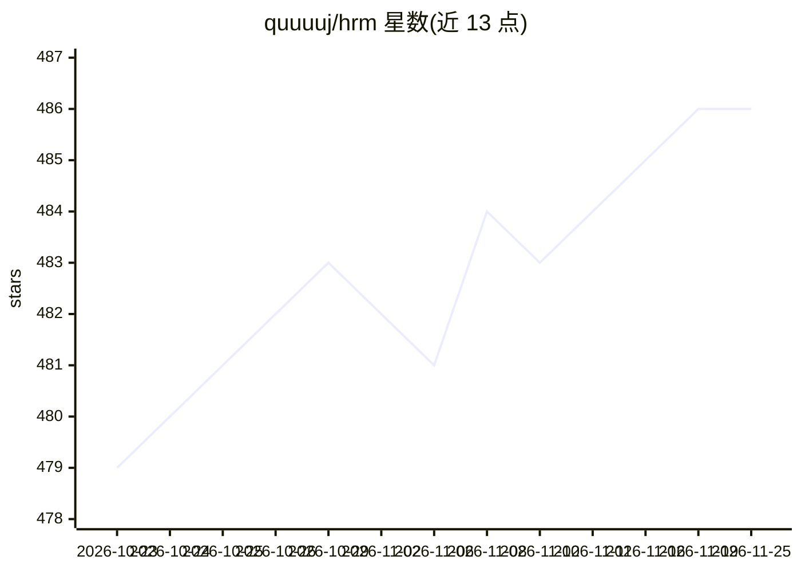

# quuuuj/hrm

⭐ 486 · Java · GPL-3.0 · 推送 2026-11-18 · [GitHub](https://github.com/quuuuj/hrm) · 个人维护 · 中文 README

**面向企业的全流程人事管理系统，含审批流与 RAG 知识库问答**

前后端分离的人力资源管理系统，覆盖组织架构、员工档案、RBAC 权限、Flowable 审批流转、考勤打卡、加班与假期管理、薪资核算与五险一金配置。知识库模块基于 PostgreSQL/pgvector 做向量存储，文档解析切块向量化后以向量召回+关键词召回+RRF 融合+重排方式检索，问答带意图分流、证据充分度评估与引用编号，流式输出。运行依赖 MySQL、Redis、PostgreSQL/pgvector、MinIO 等中间件，需配置 LLM API 密钥才能启用问答。

## 筛选速览

| 维度 | 判定 | 备注 |
|---|---|---|
| AI 角色 | `ai-enhanced` | 去掉 AI 部分产品仍成立 |
| 许可风险 | `viral` | GPL-3.0 |
| 部署形态 | `self-host` | docker 或自建部署 |
| 模型依赖 | — | README 未给出锁定关系 |
| 硬件要求 | — | 无带数字的原话,不猜 |
| 安装摩擦 | `low` | 无编译、无系统依赖或容器化 |
| 成熟度 | — | 结构信号不足 |

## 能力要点

- Flowable 8.0 审批流与业务共享本地事务
- 向量召回+关键词召回→RRF 融合→精排的 RAG 检索链路
- 双 Token 无感续期鉴权与 SSE 实时通知推送
- Excel 异步导入导出，带进度推送与失败行明细

## 适用场景

- 企业管理员工档案、考勤、假期与薪资核算
- 用审批流处理请假等人事流转
- 基于企业制度文档搭建人事政策智能问答

## 场景标签

`文档问答` `RAG` · 领域:知识与检索

## 证据(README 行号)

> L17: **数智人事** 是一套面向现代企业的高效人力资源全流程管理系统，旨在提升组织人效与员工自主服务体验。系统采用前后端分离架构，融合企业业务管理规范与先进的生成式 AI 技术：
> L20: - **智能化升级**：提供基于 RAG（检索增强生成）的企业知识库智能问答，具备员工上下文感知，覆盖政策制度等人事咨询场景。
> L19: - **传统业务闭环**：覆盖组织架构、员工全生命周期档案、菜单与角色细粒度 RBAC 权限体系、Flowable 审批流转、灵活考勤与打卡统计、精细化加班与多维假期管理、薪资核算与五险一金配置。

## 星数曲线

2026-10-23 479 → 2026-11-25 486（+7）

---
*卡片 v1 · prompt 1.4 · 生成 2026-11-25 · 置信度 mid · 依据 README sha `e05d23e200b2` · [字段定义](../../DATASET.md)*
