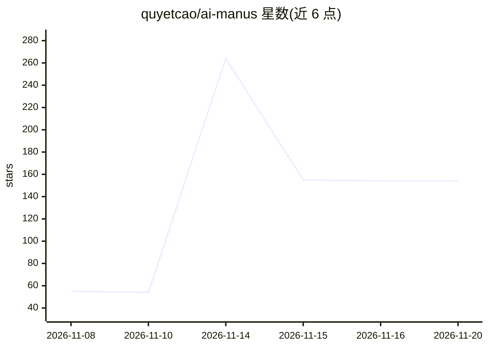

# quyetcao/ai-manus

⭐ 154 · Python · Apache-2.0 · 推送 2026-11-08 · [GitHub](https://github.com/quyetcao/ai-manus) · 个人维护

**自主执行代码与浏览器操作的通用 AI Agent 系统**

Manus 是面向任务委托的自主 AI agent：用户用自然语言下达指令后，agent 可自行编写并执行脚本、控制浏览器完成页面导航、表单填写与信息收集，并可串联代码与浏览器操作完成多步骤任务。定位为家庭、学习与轻量办公场景的后台个人助手，而非企业平台。仓库描述补充其支持在沙盒环境中运行多种工具与操作。README 提供系统兼容性表（双核 CPU、4GB 内存起）与使用步骤说明，但未给出安装命令或代码入口。

## 筛选速览

| 维度 | 判定 | 备注 |
|---|---|---|
| AI 角色 | `ai-native` | 本体是模型或模型工具 |
| 许可风险 | `permissive` | Apache-2.0 |
| 部署形态 | `None` |  |
| 模型依赖 | — | README 未给出锁定关系 |
| 硬件要求 | — | 无带数字的原话,不猜 |
| 安装摩擦 | `low` | 无编译、无系统依赖或容器化 |
| 成熟度 | — | 结构信号不足 |

## 能力要点

- 自主编写并执行代码完成任务
- 浏览器控制：导航页面、填表、收集信息
- 代码与浏览器操作可在同一任务流中衔接
- 面向家庭、学习与轻量办公的小规模任务设计

## 适用场景

- 让学生整理研究笔记、运行快速计算
- 远程工作者从多个网页收集数据并汇总
- 把重复性的小任务委托给后台 agent 处理

## 场景标签

`AI 助手` `浏览器自动化` `编码 Agent` · 领域:效率与自动化

## 证据(README 行号)

> L10: - **Autonomous Code Execution:** Manus AI agent runs code on its own to complete tasks, so you can focus on decisio
> L18: Manus is an autonomous AI agent designed to run code and control a browser on your behalf. Instead of acting like a

## 星数曲线

2026-11-08 55 → 2026-11-20 154（+99）

---
*卡片 v1 · prompt 1.4 · 生成 2026-11-17 · 置信度 mid · 依据 README sha `790070d90930` · [字段定义](../../DATASET.md)*
