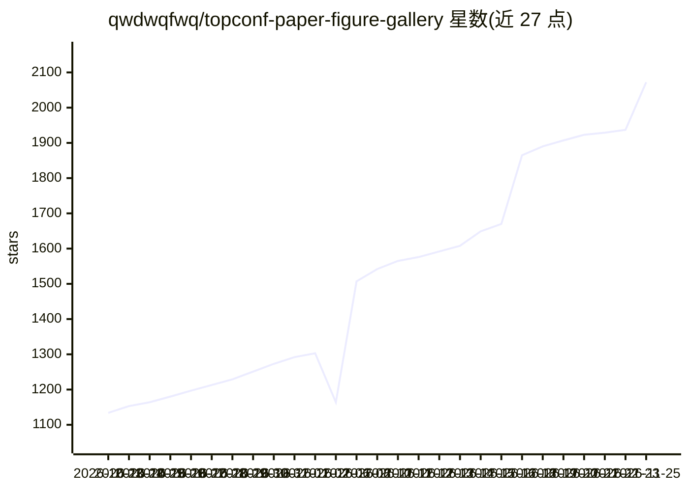

# qwdwqfwq/topconf-paper-figure-gallery

⭐ 2,072 · JavaScript · NOASSERTION · 推送 2026-11-24 · [GitHub](https://github.com/qwdwqfwq/topconf-paper-figure-gallery) · [官网](https://qwdwqfwq.github.io/topconf-paper-figure-gallery/) · 个人维护 · 中文 README

**给科研人员提供顶会论文主图版式参考画廊与生图初稿工具**

收录 ICLR/ICML/NeurIPS/CVPR/ACL/AAAI 2023–2026 共 3,452 张 Figure 1 / Teaser，按会议、年份、录取等级与视觉模式筛选，支持标题/作者/关键词全文搜索；每张图经规则初筛加人工复核。纯静态站点，克隆后本地打开即可用，数据管线开源可复现。附带 FigureForge 浏览器端工具：以画廊图为版式参考（CLIP+BM25 混合检索），结合视觉模型生成主图初稿，API Key 仅存本机。图片版权属原作者，设 72 小时下架政策。

## 筛选速览

| 维度 | 判定 | 备注 |
|---|---|---|
| AI 角色 | `ai-knowledge` | 知识聚合/清单类 |
| 许可风险 | `permissive` | NOASSERTION |
| 部署形态 | `library` | 以包/库形式分发 |
| 模型依赖 | — | README 未给出锁定关系 |
| 硬件要求 | — | 无带数字的原话,不猜 |
| 安装摩擦 | `low` | 无编译、无系统依赖或容器化 |
| 成熟度 | — | 结构信号不足 |

## 能力要点

- 3,452 张六大顶会主图，带 Best/Oral/Spotlight 等级角标
- FigureForge 在浏览器本地生成主图初稿，支持 SVG/位图两种模式
- 人工复核管线：规则剔除默认图/表格/截图后逐页检查
- 纯静态、零构建，数据管线开源可复现

## 适用场景

- 写论文主图前查找同类型顶会图的版式与配色参考
- 用 FigureForge 生成论文 Figure 1 初稿再手动编辑
- 按录取等级浏览顶会代表性论文的视觉设计

## 场景标签

`精选清单` `科研工具` `图像生成` · 领域:内容生成

## 证据(README 行号)

> L104: **顶会论文主图灵感画廊**收录六大 ML/AI 顶会 2023–2026 的 Figure 1 / Teaser：概念图、系统框架、流程图、架构图、任务全景。它是排版设计参考，不是论文排名。每张卡片链接原文，并记录会议、年份、
> L113: ### 🛠️ FigureForge Beta
> L115: FigureForge 基于画廊生成你的 Figure 1 初稿：描述论文，3,452 张顶会主图作为版式参考。免注册、无服务器，全部在浏览器本地运行。**立即试用 →**

## 星数曲线

2026-10-23 1,134 → 2026-11-25 2,072（+938）

---
*卡片 v1 · prompt 1.4 · 生成 2026-11-23 · 置信度 high · 依据 README sha `b01fe270b9d9` · [字段定义](../../DATASET.md)*
