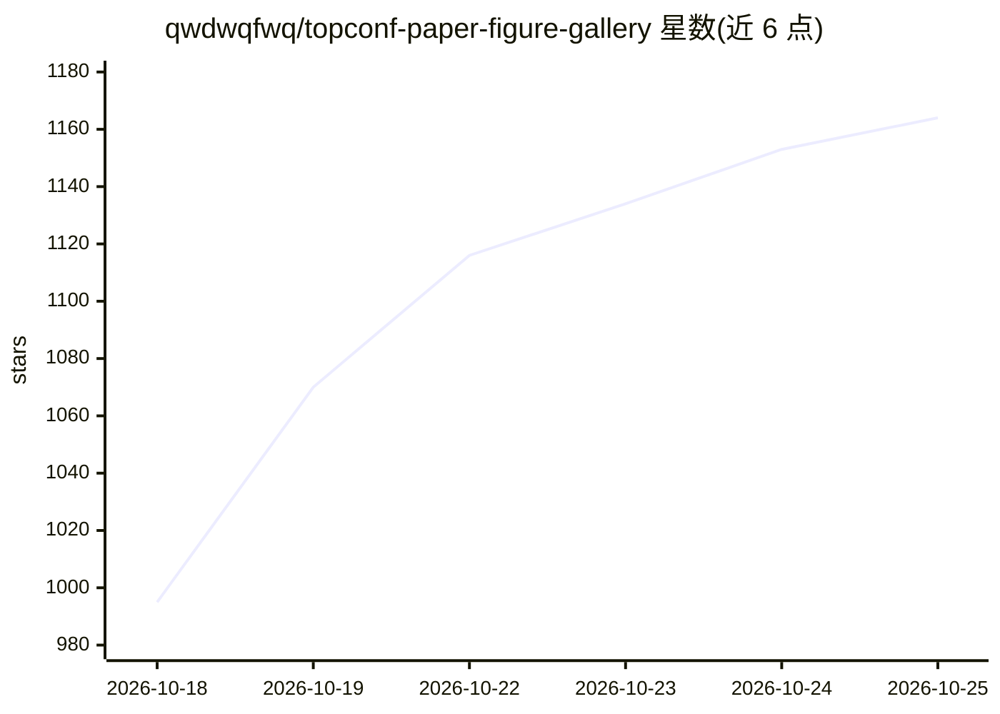

# qwdwqfwq/topconf-paper-figure-gallery

⭐ 1,164 · JavaScript · NOASSERTION · 推送 2026-10-21 · [GitHub](https://github.com/qwdwqfwq/topconf-paper-figure-gallery) · [官网](https://qwdwqfwq.github.io/topconf-paper-figure-gallery/) · 个人维护 · 中文 README

**顶会论文主图画廊（3,452 张）+ 浏览器端主图初稿生成工具**

收录 ICLR、ICML、NeurIPS、CVPR、ACL、AAAI（2023–2026）共 3,452 张 Figure 1 / Teaser 图，每张卡片链接原文并记录会议、年份、作者、录取等级角标与视觉模式标签，支持按会议/年份/等级/模式筛选与全文搜索，采集管线开源可复现。站点为纯静态 HTML/CSS/JS，克隆后双击或本地起服务即可离线浏览。附带 FigureForge（Beta）：在浏览器本地运行，用 CLIP+BM25 检索画廊参考图，自带 API Key 调用大模型生成 Figure 1 初稿（SVG/位图）。限制：图片版权归作者与出版方，教育用途、72 小时下架政策。

## 筛选速览

| 维度 | 判定 | 备注 |
|---|---|---|
| AI 角色 | `ai-knowledge` | 知识聚合/清单类 |
| 许可风险 | `permissive` | NOASSERTION |
| 部署形态 | `library` | 以包/库形式分发 |
| 模型依赖 | — | README 未给出锁定关系 |
| 硬件要求 | — | 无带数字的原话,不猜 |
| 安装摩擦 | `low` | 无编译、无系统依赖或容器化 |
| 成熟度 | `idea` | |

## 能力要点

- 六大顶会 3,452 张主图，含 Oral/Spotlight/Best 角标与视觉模式标签
- 25 条以上启发式规则 + 人工逐页复核的收录管线，开源可复现
- FigureForge 浏览器端 CLIP+BM25 混合检索 + 自带 Key 生成主图初稿
- 纯静态站点，无后端无构建，数据内联可离线打开

## 适用场景

- 画论文 Figure 1 前查找顶会主图的版式设计参考
- 按视觉模式（framework/pipeline/conceptual 等）筛选同类图找灵感
- 用 FigureForge 基于参考图快速生成可编辑的主图初稿

## 场景标签

`精选清单` `科研工具` · 领域:学习与行业

## 证据(README 行号)

> L56: **Top-Conf Figure Gallery** collects Figure 1 / teaser figures (concept diagrams, system frameworks, pipelines, arc
> L33: A searchable, filterable gallery of Figure 1 / teaser figures. Static HTML/CSS/JS, no build, works offline.
> L230: > 版本对照 / Versioning — releases 遵循 0.x semver：**v0.3**（六个会议，2,298 张，2026-09-20 发布）、**v0.4**（录取等级角标，2,730 张）、**v0.5*

## 星数曲线

2026-10-18 995 → 2026-10-25 1,164（+169）

---
*卡片 v1 · prompt 1.4 · 生成 2026-10-21 · 置信度 mid · 依据 README sha `adb694bed1bb` · [字段定义](../../DATASET.md)*
