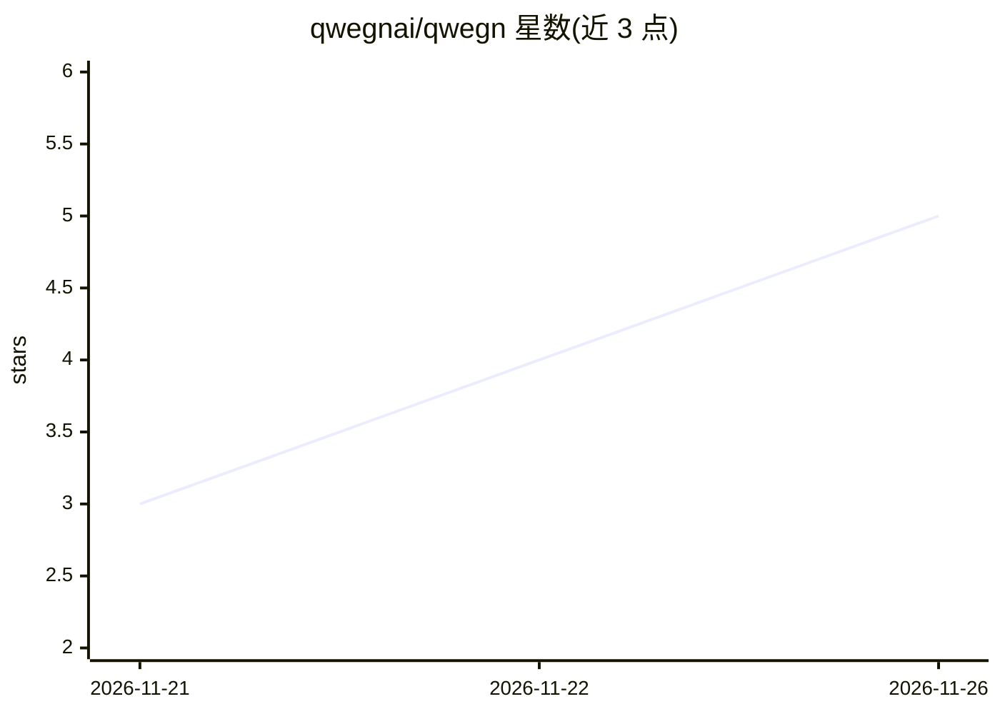

# qwegnai/qwegn

⭐ 5 · Swift · Apache-2.0 · 推送 2026-11-25 · [GitHub](https://github.com/qwegnai/qwegn) · 个人维护

**Apple Silicon 本地 LLM/VLM 推理引擎，Swift+Metal 实现**

以 Swift 6.2 与 Metal 4 从零实现的 LLM/VLM 推理引擎，运行时不依赖 MLX、llama.cpp 或 PyTorch。提供 qwg 命令行工具完成模型拉取、量化与运行，支持混合、循环与 MoE 架构，带推理 speculation、原生 Metal ViT、多种量化格式、最高 1M token 上下文与统一内存常驻或 NVMe 流式加载。需 macOS 26.2+ 与 M 系列芯片，构建需 Xcode 与 Python；提供 .pkg 安装包与菜单栏控制面板。

## 筛选速览

| 维度 | 判定 | 备注 |
|---|---|---|
| AI 角色 | `ai-ecosystem` | LLM/agent 周边工具 |
| 许可风险 | `permissive` | Apache-2.0 |
| 部署形态 | `desktop` | 安装包/桌面程序 |
| 模型依赖 | — | README 未给出锁定关系 |
| 硬件要求 | — | 无带数字的原话,不猜 |
| 安装摩擦 | `low` | 无编译、无系统依赖或容器化 |
| 成熟度 | — | 结构信号不足 |

## 能力要点

- Swift+Metal 从零实现的推理引擎，运行时不依赖 MLX/llama.cpp/PyTorch
- qwg CLI 支持模型 pull/quantize/run，官方量化模型包托管于 huggingface.co/qwegnai
- 支持最高 1M token 上下文与统一内存常驻或 NVMe 流式加载
- 提供 QWMemoryPack 仓库离线索引与缓存机制

## 适用场景

- 在 Mac 上本地运行大模型与视觉语言模型
- 为模型选择合适的量化格式并检查显存/内存预算
- 对代码仓库离线索引以加速长上下文编码任务

## 场景标签

`推理引擎` `模型量化` · 领域:训练与推理

## 证据(README 行号)

> L11: **Qwegn** (`qwg`) is a from-scratch LLM/VLM inference engine for Apple Silicon,
> L12: written in Swift 6.2 and Metal 4 — no MLX, no llama.cpp, no PyTorch at runtime.
> L57: - **Model-agnostic runtime** — hybrid, looped and MoE architectures driven by the model descriptor (`QWModelDescrip

## 星数曲线

2026-11-21 3 → 2026-11-26 5（+2）

---
*卡片 v1 · prompt 1.4 · 生成 2026-11-21 · 置信度 high · 依据 README sha `6354a670a592` · [字段定义](../../DATASET.md)*
