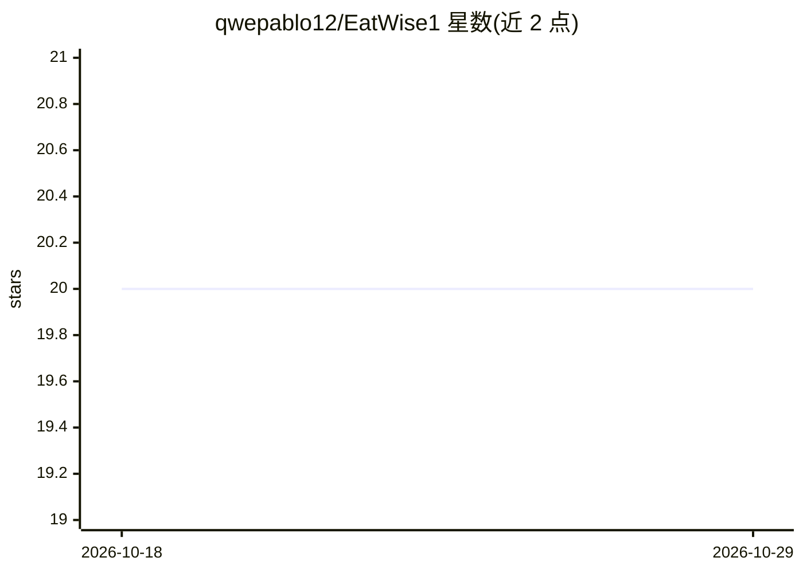

# qwepablo12/EatWise1

⭐ 20 · TypeScript · 推送 2026-08-10 · [GitHub](https://github.com/qwepablo12/EatWise1) · 个人维护

**AI 文本解析的卡路里/宏量营养追踪应用**

面向运动员的卡路里与宏量营养追踪应用，定位为"Nutrition OS"。用户以自由文本输入所吃食物（如"3 个水煮蛋和 100g 鸡胸肉"），由 Google Gemini 2.5 Flash API（结构化输出）解析并计算热量、蛋白质、脂肪与碳水。数据通过 Supabase 云端同步。提供游戏化的每日任务系统与剩余热量仪表盘。技术栈为 React Native (Expo)，README 提供Android APK，iOS 未见安装说明。

## 筛选速览

| 维度 | 判定 | 备注 |
|---|---|---|
| AI 角色 | `ai-native` | 本体是模型或模型工具 |
| 许可风险 | `none` | — |
| 部署形态 | `None` |  |
| 模型依赖 | — | README 未给出锁定关系 |
| 硬件要求 | — | 无带数字的原话,不猜 |
| 安装摩擦 | `low` | 无编译、无系统依赖或容器化 |
| 成熟度 | — | 结构信号不足 |

## 能力要点

- 自由文本输入由 Gemini 2.5 Flash 结构化输出解析营养数据
- 每日任务系统追踪宏量目标（如 >100g 蛋白质）
- Supabase 云端同步
- 基于 React Native (Expo) 构建

## 适用场景

- 运动员用一句话记录饮食并获得营养分解
- 追踪每日宏量营养目标完成情况
- 查看剩余热量额度

## 场景标签

 · 领域:健康/饮食追踪

## 证据(README 行号)

> L9: * **AI Engine:** Google Gemini 2.5 Flash API (Structured Outputs)
> L14: * **AI Cognitive Parser:** Just type what you ate (e.g., *"3 boiled eggs and 100g chicken breast"*), and the AI aut

## 星数曲线

2026-10-18 20 → 2026-10-29 20（+0）

---
*卡片 v1 · prompt 1.4 · 生成 2026-10-28 · 置信度 high · 依据 README sha `f2aefcf0d751` · [字段定义](../../DATASET.md)*
