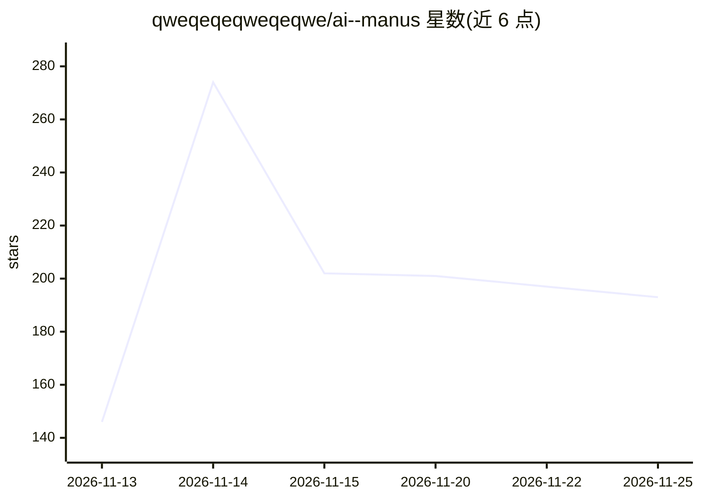

# qweqeqeqweqeqwe/ai--manus

⭐ 193 · Apache-2.0 · 推送 2026-11-14 · [GitHub](https://github.com/qweqeqeqweqeqwe/ai--manus) · 个人维护

**自主执行代码与浏览器操作的通用 AI Agent 系统**

描述自身为面向家庭、学习与轻量办公任务的自主 AI Agent：可自主编写并执行脚本、控制浏览器完成导航、填表与信息收集，并执行多步骤任务。README 未展示架构、代码示例或安装命令，仅给出兼容性表（最低双核 CPU、4GB 内存）与使用建议，事实密度低，实际实现方式不可验证。定位为无需编程背景的个人助理。

## 筛选速览

| 维度 | 判定 | 备注 |
|---|---|---|
| AI 角色 | `ai-native` | 本体是模型或模型工具 |
| 许可风险 | `permissive` | Apache-2.0 |
| 部署形态 | `None` |  |
| 模型依赖 | — | README 未给出锁定关系 |
| 硬件要求 | — | 无带数字的原话,不猜 |
| 安装摩擦 | `low` | 无编译、无系统依赖或容器化 |
| 成熟度 | — | 结构信号不足 |

## 能力要点

- 自主编写并执行代码完成任务
- 浏览器控制：导航、填表、信息收集
- 代码与浏览器操作可在同一任务流中衔接

## 适用场景

- 收集研究资料并整理笔记
- 自动填写重复性网页表单
- 运行快速脚本实验与轻量办公数据汇总

## 场景标签

`AI 助手` `浏览器自动化` `编码 Agent` · 领域:效率与自动化

## 证据(README 行号)

> L10: - **Autonomous Code Execution:** Manus AI agent runs code on its own to complete tasks, so you can focus on decisio
> L18: Manus is an autonomous AI agent designed to run code and control a browser on your behalf. Instead of acting like a

## 星数曲线

2026-11-13 146 → 2026-11-25 193（+47）

---
*卡片 v1 · prompt 1.4 · 生成 2026-11-17 · 置信度 low · 依据 README sha `544a8e299555` · [字段定义](../../DATASET.md)*
