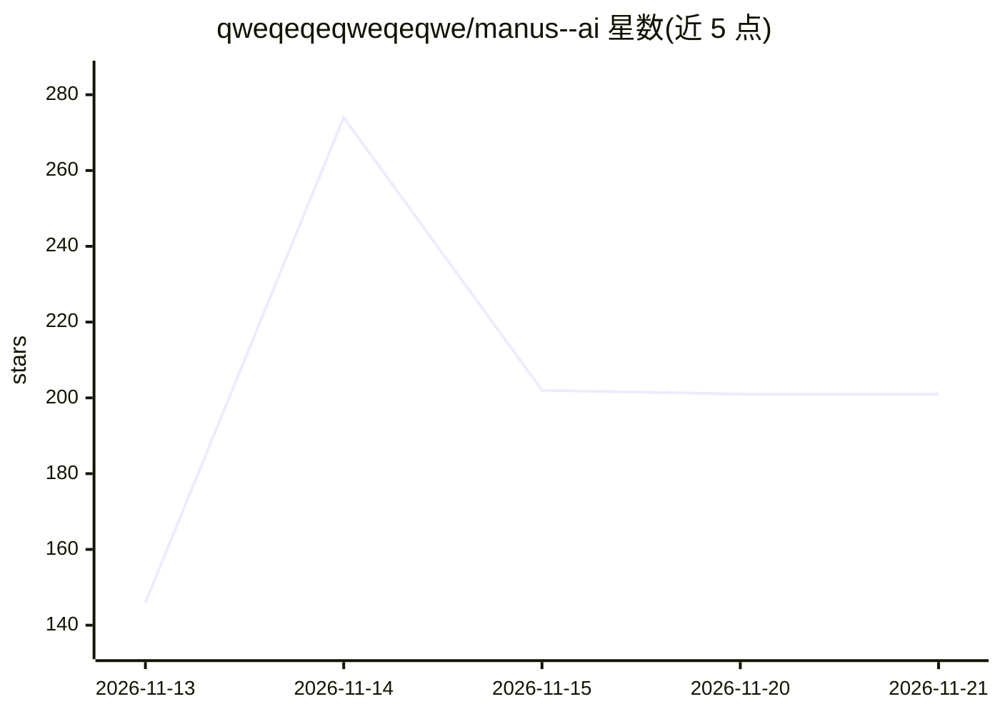

# qweqeqeqweqeqwe/manus--ai

⭐ 201 · Apache-2.0 · 推送 2026-11-14 · [GitHub](https://github.com/qweqeqeqweqeqwe/manus--ai) · 个人维护

**面向个人用户的自主 AI Agent：代为执行代码与浏览器操作**

README 宣称的自主 AI 代理系统，描述为可自行编写并执行脚本、控制浏览器导航网页、填表与采集信息，并以个人后台助手形式处理多步任务；定位是家庭、学习与轻量办公场景的小型助手，而非企业平台。描述中提到沙箱环境运行工具。README 以功能介绍与使用建议为主，未给出具体的安装命令、模型接入方式或代码入口；兼容性表列出 4GB 内存起步的硬件建议。

## 筛选速览

| 维度 | 判定 | 备注 |
|---|---|---|
| AI 角色 | `ai-native` | 本体是模型或模型工具 |
| 许可风险 | `permissive` | Apache-2.0 |
| 部署形态 | `None` |  |
| 模型依赖 | — | README 未给出锁定关系 |
| 硬件要求 | — | 无带数字的原话,不猜 |
| 安装摩擦 | `low` | 无编译、无系统依赖或容器化 |
| 成熟度 | — | 结构信号不足 |

## 能力要点

- 自主执行代码与脚本（自主代码执行）
- 浏览器控制：导航网页、填表、采集信息
- 代码与浏览器操作在同一流程内衔接
- 以后台个人助手形式处理重复性多步任务

## 适用场景

- 让学生整理研究笔记、跑快速计算
- 让代理替我浏览多个网页收集数据并汇总
- 把重复的小任务委托给后台代理处理

## 场景标签

`AI 助手` `浏览器自动化` `编码 Agent` · 领域:效率与自动化

## 证据(README 行号)

> L10: - **Autonomous Code Execution:** Manus AI agent runs code on its own to complete tasks, so you can focus on decisio
> L18: Manus is an autonomous AI agent designed to run code and control a browser on your behalf. Instead of acting like a

## 星数曲线

2026-11-13 146 → 2026-11-21 201（+55）

---
*卡片 v1 · prompt 1.4 · 生成 2026-11-17 · 置信度 mid · 依据 README sha `544a8e299555` · [字段定义](../../DATASET.md)*
