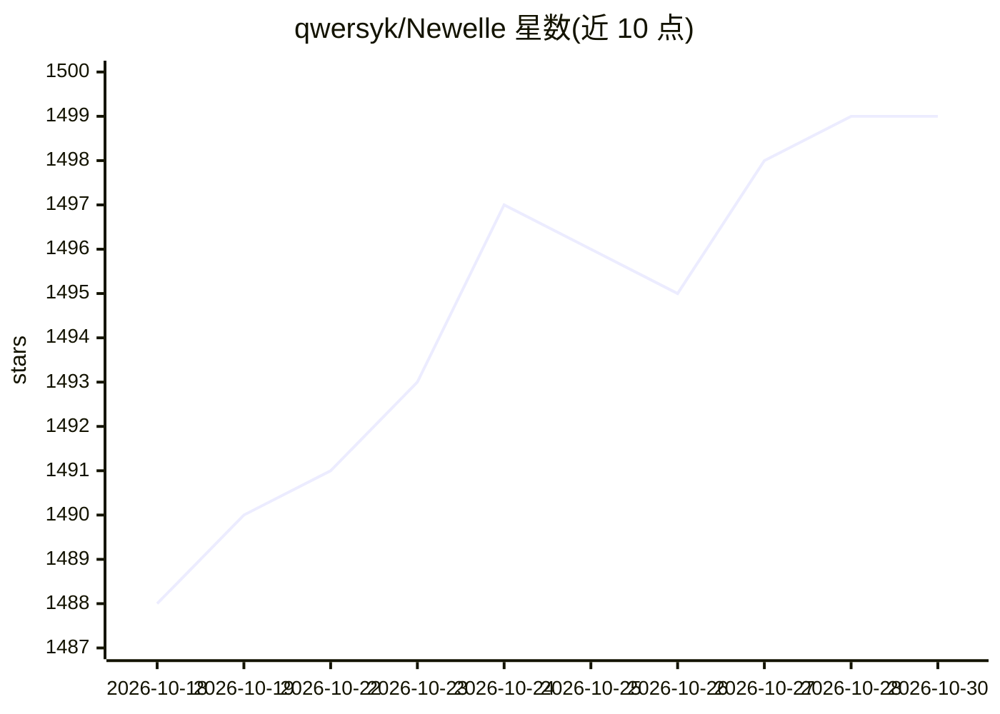

# qwersyk/Newelle

⭐ 1,499 · Python · GPL-3.0 · 推送 2026-10-28 · [GitHub](https://github.com/qwersyk/Newelle) · [官网](https://newelle.qsk.me) · 个人维护

**GNOME 桌面上的虚拟助手应用，本地/多模型对话与文件管理**

基于 GTK4/Adwaita 的 Linux 桌面 AI 助手应用，面向终端用户：支持多种模型与供应商，可从应用内下载本地模型并经 Llama.cpp 或 Ollama 运行；提供语音对话、实时通话模式、长期记忆、文档对话、图像生成、网页搜索与抓取、动态上下文摘要、终端命令执行与文件权限控制等功能。支持扩展与 MCP 工具接入，内置迷你窗口模式（Ctrl+G 唤起）。分发以 Flathub 为主，也可源码编译或 nix 运行；Flathub 版受沙箱限制。

## 筛选速览

| 维度 | 判定 | 备注 |
|---|---|---|
| AI 角色 | `ai-native` | 本体是模型或模型工具 |
| 许可风险 | `viral` | GPL-3.0 |
| 部署形态 | `None` |  |
| 模型依赖 | local-ok | 支持本地模型 |
| 硬件要求 | — | 无带数字的原话,不猜 |
| 安装摩擦 | `low` | 无编译、无系统依赖或容器化 |
| 成熟度 | — | 结构信号不足 |

## 能力要点

- 多供应商与本地模型支持（Llama.cpp / Ollama 运行）
- 语音对话（STT/TTS、唤醒词）与实时通话模式
- 扩展系统、MCP 工具与 Claude/Codex 技能兼容
- 长期记忆、文档对话、动态上下文摘要与文件权限管理

## 适用场景

- 在 Linux 桌面用一个应用统一访问云端与本地模型
- 语音或迷你窗口快捷唤起 AI 助手完成日常任务
- 让 AI 在受控文件权限下管理本地文件与执行命令

## 场景标签

`AI 助手` `图像生成` · 领域:对话与助手

## 证据(README 行号)

> L3:  Newelle - Your Ultimate Virtual Assistant
> L32: - 🚀 **Flexible Model Support**: Choose from mutliple AI models and providers to fit your specific needs
> L33: - 📚 **Local models**: Download local models directly from Newelle, and run them using Llama.cpp or Ollama.

## 星数曲线

2026-10-18 1,488 → 2026-10-30 1,499（+11）

---
*卡片 v1 · prompt 1.4 · 生成 2026-10-21 · 置信度 high · 依据 README sha `33532df7d234` · [字段定义](../../DATASET.md)*
