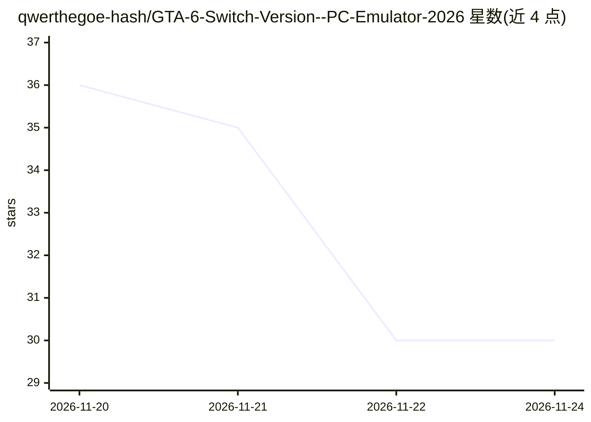

# qwerthegoe-hash/GTA-6-Switch-Version--PC-Emulator-2026

⭐ 30 · Rust · Apache-2.0 · 推送 2026-11-19 · [GitHub](https://github.com/qwerthegoe-hash/GTA-6-Switch-Version--PC-Emulator-2026) · 个人维护

**面向 Windows 玩家的 GTA VI PC 版安装准备与配置指南**

一个围绕尚未发布 PC 版的 Grand Theft Auto VI 的 Windows 安装与配置资源：提供 Windows 更新、GPU 驱动（NVIDIA/AMD/Intel 官方驱动页链接）、存储检查、Rockstar Games Launcher 准备等分步指南，以及图形设置、FPS 排障、卡顿与显示问题的通用排查条目。明确声明其安装包不含游戏文件，游戏需从授权渠道购买；官方 PC 配置要求与发售日期尚未公布，表格留空待更新。

## 筛选速览

| 维度 | 判定 | 备注 |
|---|---|---|
| AI 角色 | `ai-knowledge` | 知识聚合/清单类 |
| 许可风险 | `permissive` | Apache-2.0 |
| 部署形态 | `desktop` | 安装包/桌面程序 |
| 模型依赖 | — | README 未给出锁定关系 |
| 硬件要求 | — | 无带数字的原话,不猜 |
| 安装摩擦 | `low` | 无编译、无系统依赖或容器化 |
| 成熟度 | `idea` | |

## 能力要点

- Windows 准备检查清单：系统版本、DirectX、驱动、存储检查
- 三类厂商（NVIDIA/AMD/Intel）官方驱动下载指引
- 通用 PC 游戏性能因素解析（分辨率/纹理/阴影/光追/超分/帧生成）
- 常见故障分类排查：低帧率、卡顿、显示与安装错误

## 适用场景

- 在 GTA VI PC 版发布前提前准备 Windows 环境与驱动
- 排查 PC 游戏中的低帧率与卡顿问题
- 按步骤配置 Rockstar Games Launcher 与系统游戏设置

## 场景标签

 · 领域:游戏/安装配置指南

## 证据(README 行号)

> L5: A dedicated PC installation and configuration resource for Grand Theft Auto VI, covering Windows preparation, graphi
> L49: The companion installer does not contain or install GTA VI game files.

## 星数曲线

2026-11-20 36 → 2026-11-24 30（-6）

---
*卡片 v1 · prompt 1.4 · 生成 2026-11-20 · 置信度 mid · 依据 README sha `6954d37a13d3` · [字段定义](../../DATASET.md)*
