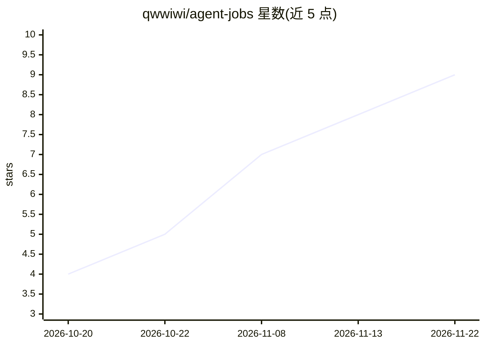

# qwwiwi/agent-jobs

⭐ 9 · Go · MIT · 推送 2026-11-11 · [GitHub](https://github.com/qwwiwi/agent-jobs) · 个人维护

**让 Claude Code 主会话把长任务派发为受管控的后台 claude -p 作业**

单二进制 Go 编写的作业编排器：主 Claude Code 会话将多步长任务写成 brief 并派发为后台 claude -p 作业，每个作业运行在独立 git worktree，带时间/轮次/预算上限与工具调用 guard，结束时按固定格式产出报告；支持并行槽位队列、会话或守护进程重启后作业存活、以及按 brief→checklist→盲审 judge 流程验收大型任务。通过 stdio MCP 服务器供会话调用，每 agent 使用一个 SQLite 文件。依赖 Go 1.27、git、claude CLI 与 tmux，仅支持 Linux 与 macOS。

## 筛选速览

| 维度 | 判定 | 备注 |
|---|---|---|
| AI 角色 | `ai-ecosystem` | LLM/agent 周边工具 |
| 许可风险 | `permissive` | MIT |
| 部署形态 | `None` |  |
| 模型依赖 | locked-api |  |
| 硬件要求 | — | 无带数字的原话,不猜 |
| 安装摩擦 | `low` | 无编译、无系统依赖或容器化 |
| 成熟度 | — | 结构信号不足 |

## 能力要点

- 每个作业独立 git worktree + 硬性时间/轮次/预算上限 + 工具调用 guard
- 主会话经 MCP 服务器（stdio）派发与检查作业，保持自身上下文精简
- brief→checklist→盲审 judge 的需求逐行验收流程
- 作业并行槽位运行并排队，重启会话或守护进程后存活

## 适用场景

- 把 overnight 修复循环、代码评审、调研派发为后台作业
- 用 checklist 与盲审 judge 验收多需求的大功能开发
- 多作业并行跑，主会话保持可用继续对话

## 场景标签

`代码审查` `编码 Agent` · 领域:编码与开发

## 证据(README 行号)

> L16: **Agent Jobs turns one Claude Code session into a team lead.** You give the session a large task once. It writes br
> L53: **3. Give the session the tools.** The session drives jobs through an MCP server on stdio; register it in your sess
> L23: It is a single Go binary with one SQLite file per agent. It runs on Linux (systemd user service) and macOS (launchd

## 星数曲线

2026-10-20 4 → 2026-11-22 9（+5）

---
*卡片 v1 · prompt 1.4 · 生成 2026-11-20 · 置信度 high · 依据 README sha `2870762523d5` · [字段定义](../../DATASET.md)*
