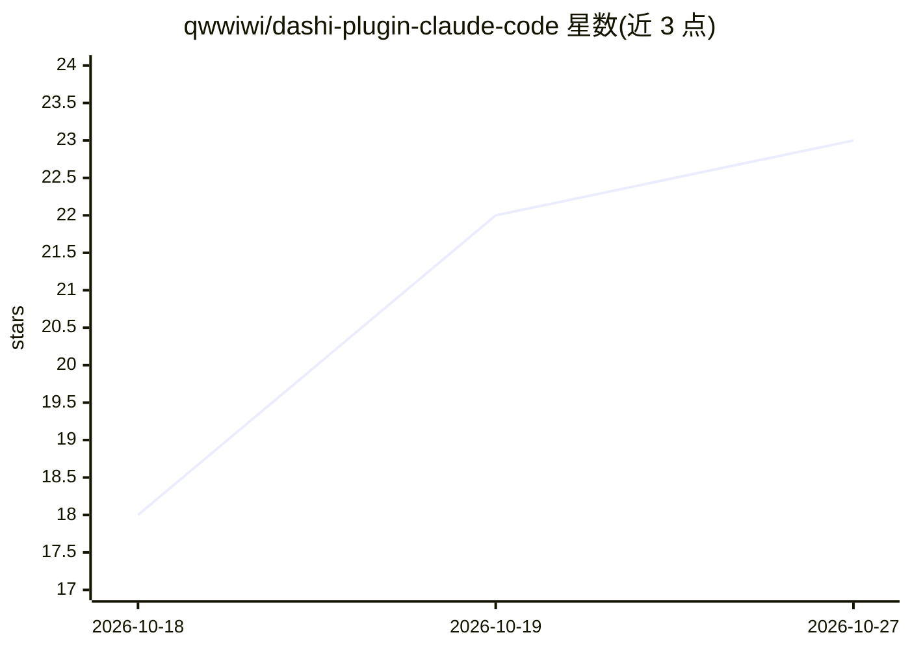

# qwwiwi/dashi-plugin-claude-code

⭐ 23 · TypeScript · Apache-2.0 · 推送 2026-10-17 · [GitHub](https://github.com/qwwiwi/dashi-plugin-claude-code) · 个人维护

**把 Claude Code 会话接入 Telegram 的频道插件，单一会话免按条计费**

基于 Bun + TypeScript 的 Claude Code channel 插件：Telegram 消息经长轮询拉取、allowlist 门控后推入一个持续运行的交互式 Claude Code 会话，回复经脱敏、HTML 校验、分块与限速后发回 Telegram。用量计入 Anthropic Max 订阅，替代每条消息新起 headless 进程并单独计费的 claude -p 网关模式（2026-06-15 切换截止）。支持多聊天路由（每聊天独立 tmux 会话）、权限确认按钮中继、由五个 Claude Code hooks 驱动的进度/任务镜像，以及终端镜像。面向自托管 Claude Code 的开发者/运维者，需配置 user_id 白名单方可使用。

## 筛选速览

| 维度 | 判定 | 备注 |
|---|---|---|
| AI 角色 | `ai-ecosystem` | LLM/agent 周边工具 |
| 许可风险 | `permissive` | Apache-2.0 |
| 部署形态 | `library` | 以包/库形式分发 |
| 模型依赖 | — | README 未给出锁定关系 |
| 硬件要求 | — | 无带数字的原话,不猜 |
| 安装摩擦 | `low` | 无编译、无系统依赖或容器化 |
| 成熟度 | — | 结构信号不足 |

## 能力要点

- 单一交互式 Claude Code 会话承载 Telegram 消息，用量留在 Max 订阅内
- multichat 路由：一个 bot 按聊天分发到独立 tmux 会话，支持每聊天 persona 叠加
- 权限确认中继：sudo 等敏感工具请求以 Telegram 按钮确认，决策写入审计 JSONL
- 五个 Claude Code hooks 驱动三个进度面（状态气泡/活动滚动消息/任务里程碑镜像）

## 适用场景

- 通过 Telegram 远程驱动常驻的 Claude Code agent，无需 SSH
- 同一身份在个人 DM、工作群等多个聊天并行运行 agent
- 对敏感工具调用用 Telegram 按钮做人工审批并留存审计记录

## 场景标签

`编码 Agent` · 领域:编码与开发

## 证据(README 行号)

> L11: **A Telegram → Claude Code channel plugin.** It turns an ordinary, live Claude Code session into a Telegram agent: 
> L37: It is a Claude Code **channel plugin** (Bun + TypeScript, grammY for Telegram, Zod for validation). The message flo
> L53: Two ways to launch: a standalone Bun process (`bun start`, a quick token check) or production via `claude --dangero

## 星数曲线

2026-10-18 18 → 2026-10-27 23（+5）

---
*卡片 v1 · prompt 1.4 · 生成 2026-10-27 · 置信度 mid · 依据 README sha `c9332fab3482` · [字段定义](../../DATASET.md)*
