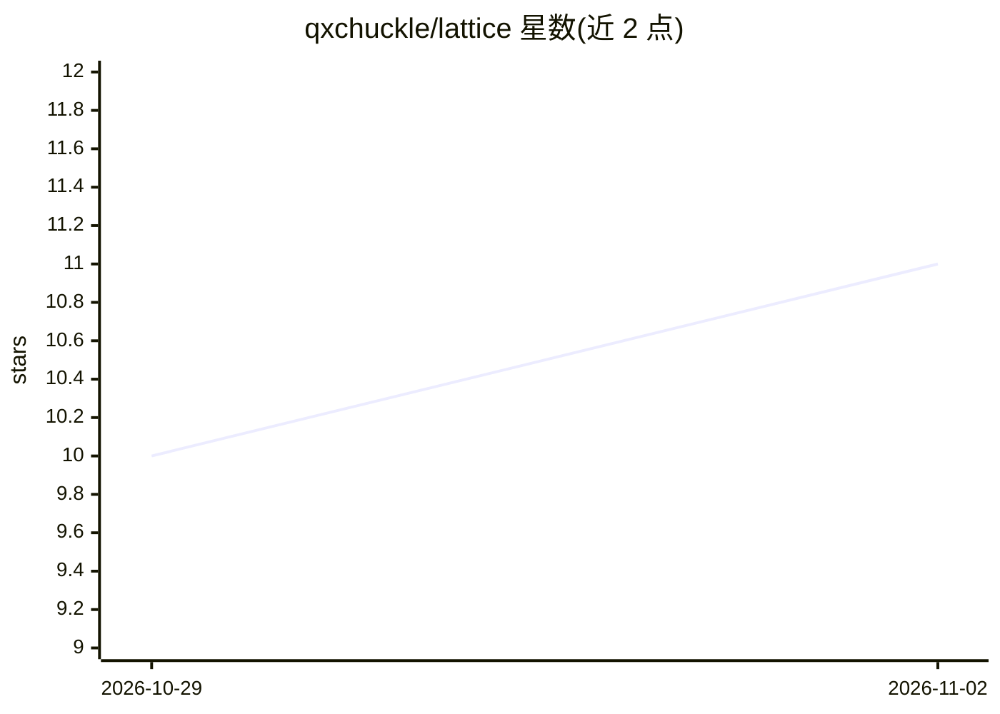

# qxchuckle/lattice

⭐ 11 · TypeScript · MIT · 推送 2026-10-22 · [GitHub](https://github.com/qxchuckle/lattice) · [官网](https://lattice.qcqx.cn/) · 个人维护 · 中文 README

**本地优先的研发记忆与工作流层，供 AI 辅助开发复用**

Lattice 是本地优先的工程记忆与工作流层，把规格、任务、决策、项目关系与经验存入 ~/.lattice，成为结构化、可搜索、可版本化的工程资产，通过 CLI、VS Code 扩展与 Web 工作台供人和 AI agent 使用。提供分层规格级联、任务与检查点、基于指纹的项目注册表、本地嵌入 RAG 检索、双轨同步（origin 单仓多机 / domains 多人协作）。`ltc init` 可将工作流注入 Cursor / Claude Code / Qoder / Trae。无遥测，数据仅在本机，同步只触及用户配置的 Git remote。

## 筛选速览

| 维度 | 判定 | 备注 |
|---|---|---|
| AI 角色 | `ai-ecosystem` | LLM/agent 周边工具 |
| 许可风险 | `permissive` | MIT |
| 部署形态 | `library` | 以包/库形式分发 |
| 模型依赖 | — | README 未给出锁定关系 |
| 硬件要求 | — | 无带数字的原话,不猜 |
| 安装摩擦 | `low` | 无编译、无系统依赖或容器化 |
| 成熟度 | — | 结构信号不足 |

## 能力要点

- 全局/用户/项目分层规格，自动级联覆盖
- `ltc context` 一次性组装当前仓库的规格、活动任务与相关记忆
- `ltc init` 向 Cursor / Claude Code / Qoder / Trae 注入工作流
- 本地嵌入 + 全文索引的 RAG 搜索与 Cytoscape 知识图谱

## 适用场景

- 跨项目、跨会话、跨 agent 复用规格与决策记录
- 进入陌生仓库前先读取其约定与活动任务
- 为 AI agent 提供启动读记忆、工作中记录、归档时提炼的工作流

## 场景标签

 · 领域:开发者工具/AI 辅助研发

## 证据(README 行号)

> L22: Lattice is a local-first **engineering memory and workflow layer**. It turns specs, tasks, decisions, project relat
> L51: |**Workflow injection**|`ltc init` injects the Lattice workflow into Cursor / Claude Code / Qoder / Trae — read mem
> L100: - Everything lives in `~/.lattice` on your machine — projects, specs, tasks, checkpoints, the search index.

## 星数曲线

2026-10-29 10 → 2026-11-02 11（+1）

---
*卡片 v1 · prompt 1.4 · 生成 2026-11-02 · 置信度 high · 依据 README sha `f4eb98aee00b` · [字段定义](../../DATASET.md)*
