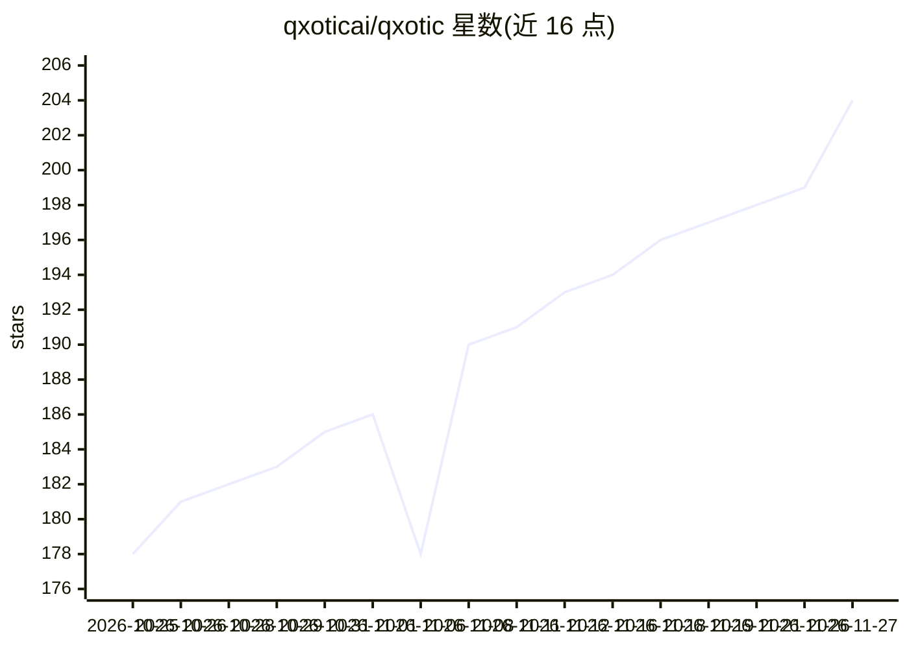

# qxoticai/qxotic

⭐ 204 · Java · Apache-2.0 · 推送 2026-11-25 · [GitHub](https://github.com/qxoticai/qxotic) · [官网](https://qxotic.ai) · 个人维护

**JVM 开发者的纯 Java 本地 AI 推理栈**

面向 JVM 的本地 AI 全栈：包含推理引擎 jinfer（聊天/视觉/音频/embedding/重排/语音合成）、纯 Java 分词器 toknroll、多 ISA 矩阵乘法内核 jam、支持 CUDA/HIP/Metal/OpenCL 等后端的张量引擎 jota，以及 GGUF 与 Safetensors 格式读写模块。AI 全程在 JVM 上运行，无 Python、无 ONNX、无外部服务；支持 GraalVM Native Image 生成自包含二进制。提供 OpenAI 兼容服务器与实时转录演示；构建需 JDK 25、Maven 3.9 与 cmake。

## 筛选速览

| 维度 | 判定 | 备注 |
|---|---|---|
| AI 角色 | `ai-ecosystem` | LLM/agent 周边工具 |
| 许可风险 | `permissive` | Apache-2.0 |
| 部署形态 | `None` |  |
| 模型依赖 | — | README 未给出锁定关系 |
| 硬件要求 | — | 无带数字的原话,不猜 |
| 安装摩擦 | `high` | 编译与系统依赖俱全 |
| 成熟度 | — | 结构信号不足 |

## 能力要点

- 纯 Java 推理引擎支持聊天、视觉、音频、embedding、重排与 TTS
- 张量引擎统一 CPU/GPU API，支持 CUDA、HIP、Metal、OpenCL、Mojo 后端
- GraalVM Native Image 一级支持，自包含二进制、毫秒启动
- 提供 OpenAI 兼容 server 与基于 Parakeet 的实时语音转录

## 适用场景

- 在 JVM 应用中嵌入本地 LLM 推理而无需 Python 或外部服务
- 用 GraalVM 打包成自包含的本地 AI 命令行工具
- 通过 OpenAI 兼容接口为现有客户端提供本地模型服务
- 在 JVM 上做实时语音转录

## 场景标签

`推理引擎` `语音识别` `语音合成` · 领域:内容生成

## 证据(README 行号)

> L12: Quixotic AI provides a complete, open stack for local AI on the JVM.
> L34: |`jinfer`|AI inference engine|**Local AI inference for the JVM.** Chat, vision, audio, embeddings, reranking, decis

## 星数曲线

2026-10-25 178 → 2026-11-27 204（+26）

---
*卡片 v1 · prompt 1.4 · 生成 2026-11-25 · 置信度 high · 依据 README sha `58db1c4b5e6f` · [字段定义](../../DATASET.md)*
