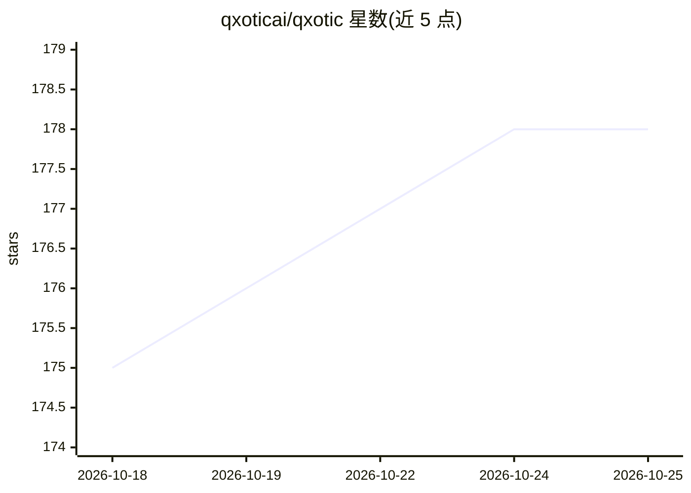

# qxoticai/qxotic

⭐ 178 · Java · Apache-2.0 · 推送 2026-10-13 · [GitHub](https://github.com/qxoticai/qxotic) · [官网](https://qxotic.ai) · 组织维护

**JVM 上的纯 Java 本地 AI 推理栈：聊天/语音/嵌入一 jar 搞定**

面向 JVM 开发者的本地 AI 完整开源栈：jinfer 推理引擎支持聊天、视觉、音频、嵌入、重排与语音合成；toknroll 提供 LLM 分词器；gguf/safetensors 读写器覆盖 llama.cpp 与 HuggingFace 模型格式；jota 张量引擎统一 CPU 与 GPU（CUDA/HIP/Metal/OpenCL）后端。无 Python、无 ONNX、无外部服务，支持 GraalVM Native Image 与 OpenAI 兼容服务器。演示需 JDK 25 与 JBang，源码构建另需 Maven 与 C 编译器。

## 筛选速览

| 维度 | 判定 | 备注 |
|---|---|---|
| AI 角色 | `ai-ecosystem` | LLM/agent 周边工具 |
| 许可风险 | `permissive` | Apache-2.0 |
| 部署形态 | `None` |  |
| 模型依赖 | — | README 未给出锁定关系 |
| 硬件要求 | — | 无带数字的原话,不猜 |
| 安装摩擦 | `high` | 编译与系统依赖俱全 |
| 成熟度 | — | 结构信号不足 |

## 能力要点

- 端到端运行在 JVM 的本地推理引擎（聊天/视觉/音频/嵌入/TTS）
- 统一张量 API 覆盖 Java、C、CUDA、HIP、Metal、OpenCL、Mojo
- GGUF 与 Safetensors 纯 Java 读写，零依赖
- OpenAI 兼容服务器与实时语音转录示例

## 适用场景

- 在 Java 应用中集成本地 LLM 推理，无需 Python 或外部服务
- 启动 OpenAI 兼容的本地推理服务
- 在 JVM 内做分词、嵌入与实时语音转录
- 用 GraalVM Native Image 打包自包含 AI 二进制

## 场景标签

`推理引擎` `语音合成` `语音识别` · 领域:内容生成

## 证据(README 行号)

> L12: Quixotic AI provides a complete, open stack for local AI on the JVM.
> L34: |`jinfer`|AI inference engine|**Local AI inference for the JVM.** Chat, vision, audio, embeddings, reranking, text-
> L37: |`jota`|Tensor engine|**Write once, accelerate everywhere.** Java, C, CUDA, HIP, Metal, OpenCL, Mojo|

## 星数曲线

2026-10-18 175 → 2026-10-25 178（+3）

---
*卡片 v1 · prompt 1.4 · 生成 2026-10-22 · 置信度 high · 依据 README sha `fc4e7576af96` · [字段定义](../../DATASET.md)*
