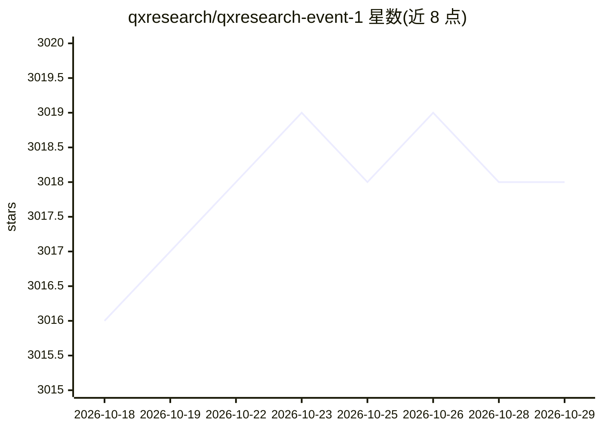

# qxresearch/qxresearch-event-1

⭐ 3,018 · Python · MIT · 推送 2026-07-10 · [GitHub](https://github.com/qxresearch/qxresearch-event-1) · [官网](https://www.youtube.com/qxresearch) · 组织维护

**50+ 个 10 行代码 Python 应用教程集合，含 ML 小应用**

qxresearch 维护的 Python 实战教程仓库：收录 50 余个用约 10 行代码实现的 Python 应用，覆盖 GUI（tkinter）、计算机视觉、API 开发、PDF 处理、语音录制等，另有一组基于 OpenAI ChatGPT/Whisper API 的机器学习应用（邮件自动化、自定义聊天机器人、语音助手、网页摘要、微调 GPT 等）。每个项目配 YouTube 视频讲解，安装方式为下载 ZIP 后 pip install -r requirements.txt 并在各项目 yml 文件中填入 API key，各项目设置步骤可能不同。

## 筛选速览

| 维度 | 判定 | 备注 |
|---|---|---|
| AI 角色 | `ai-knowledge` | 知识聚合/清单类 |
| 许可风险 | `permissive` | MIT |
| 部署形态 | `library` | 以包/库形式分发 |
| 模型依赖 | — | README 未给出锁定关系 |
| 硬件要求 | — | 无带数字的原话,不猜 |
| 安装摩擦 | `low` | 无编译、无系统依赖或容器化 |
| 成熟度 | — | 结构信号不足 |

## 能力要点

- 50+ 个约 10 行代码的 Python 应用，覆盖 GUI/视觉/API/PDF/语音
- 一组基于 ChatGPT 与 Whisper API 的机器学习应用（聊天机器人、语音助手、微调等）
- 每个项目配套 YouTube 视频讲解

## 适用场景

- 初学者通过短代码样例学习 Python 应用开发
- 参考 ChatGPT/Whisper API 的快速上手小项目
- 参与 Hacktoberfest 贡献开源教程项目

## 场景标签

`教程课程` · 领域:学习与行业

## 证据(README 行号)

> L5: Welcome to our GitHub repository featuring 50+ Python applications with only 10 lines of code! In this repository, y
> L40: `chatGPT`

## 星数曲线

2026-10-18 3,016 → 2026-10-29 3,018（+2）

---
*卡片 v1 · prompt 1.4 · 生成 2026-10-20 · 置信度 mid · 依据 README sha `906deb913887` · [字段定义](../../DATASET.md)*
