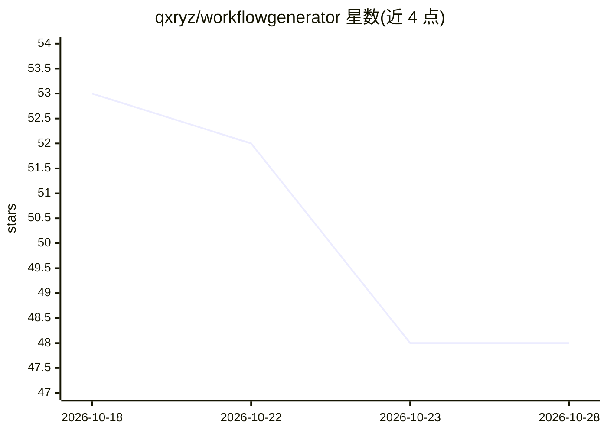

# qxryz/workflowgenerator

⭐ 48 · TypeScript · AGPL-3.0 · 推送 2026-10-27 · [GitHub](https://github.com/qxryz/workflowgenerator) · [官网](https://workflow.zhouzhou.dev) · 个人维护 · 中文 README

**无限画布上的多模态 AI 创作 Agent 工作台（BYOK）**

开源桌面应用（macOS Apple Silicon）：在无限画布上组织文本、图片、视频、音频与生成配置节点，连接成工作流并填写提示词与参考素材。内置 Zodiac Agent 运行组件（基于 OpenCode），可对话生成画布内容与阶段计划，媒体生成由用户手动启动；自带打包的运行组件，无需另装 Node.js 或 Rust。BYOK 模式，用户在“模型与渠道”填写 API Key。另有功能受限的网页尝鲜版。代码以 AGPL-3.0 发布，含多来源第三方素材。

## 筛选速览

| 维度 | 判定 | 备注 |
|---|---|---|
| AI 角色 | `ai-native` | 本体是模型或模型工具 |
| 许可风险 | `viral` | AGPL-3.0 |
| 部署形态 | `None` |  |
| 模型依赖 | — | README 未给出锁定关系 |
| 硬件要求 | — | 无带数字的原话,不猜 |
| 安装摩擦 | `low` | 无编译、无系统依赖或容器化 |
| 成熟度 | `idea` | |

## 能力要点

- 无限画布节点式工作流，支持文本/图片/视频/音频/生成配置节点
- 内置 Zodiac Agent 运行组件，无需另装 Node.js 或 Rust
- BYOK：自带一个免费渠道与语音模型预设，其余渠道填 API Key
- 数据本地保存在 ~/.zodiac，支持目录备份与软件内更新

## 适用场景

- 在画布上组织提示词、参考素材并生成多模态内容
- 通过 Zodiac 对话让 Agent 准备画布内容与阶段计划
- 自带 API Key 使用各家模型服务进行创作

## 场景标签

`提示工程` `多模态` · 领域:Agent 开发

## 证据(README 行号)

> L5:  开源画布设计 Agent 工作台。用无限画布组织提示词、参考素材和生成结果；在同一工作流中与 Zodiac 对话、审核计划并运行创作任务。
> L15: 1. 从“新建画布”进入工作流，添加文本、图片、视频、音频或生成配置节点。
> L16: 2. 连接节点并填写提示词与参考素材；也可以打开右上角的 Zodiac，描述想制作的内容。

## 星数曲线

2026-10-18 53 → 2026-10-28 48（-5）

---
*卡片 v1 · prompt 1.4 · 生成 2026-10-25 · 置信度 high · 依据 README sha `3cec01cd5b17` · [字段定义](../../DATASET.md)*
