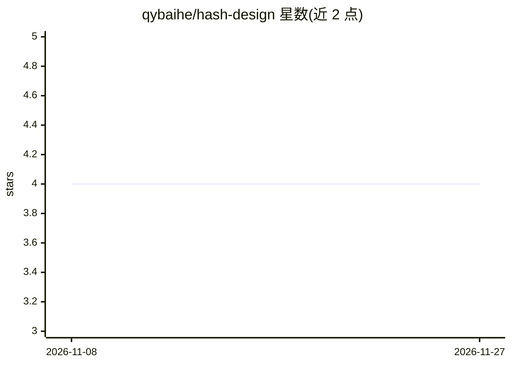

# qybaihe/hash-design

⭐ 4 · TypeScript · MIT · 推送 2026-11-03 · [GitHub](https://github.com/qybaihe/hash-design) · [官网](https://qybaihe.github.io/hash-design/) · 个人维护 · 中文 README

**给编码 Agent 的随机设计方向生成器：SHA-256 哈希映射设计风格**

以 MCP server、Agent Skill、CLI 和 TypeScript 库四形态发布于 npm 的工具：用系统真随机数生成 SHA-256 哈希，按固定规则映射到 40 种真实设计流派对应的色板、字体、字阶、网格、密度等参数，冻结为可从 ref 复现的设计 brief；Agent 逐条列出方向、渲染并排预览，用户选定后据此构建页面。默认输出网页，可指定幻灯片、移动端界面、仪表盘、海报或 HTML 邮件等场景。需要 Node.js ≥ 20，Skill 正文为中文。

## 筛选速览

| 维度 | 判定 | 备注 |
|---|---|---|
| AI 角色 | `ai-ecosystem` | LLM/agent 周边工具 |
| 许可风险 | `permissive` | MIT |
| 部署形态 | `library` | 以包/库形式分发 |
| 模型依赖 | — | README 未给出锁定关系 |
| 硬件要求 | — | 无带数字的原话,不猜 |
| 安装摩擦 | `low` | 无编译、无系统依赖或容器化 |
| 成熟度 | — | 结构信号不足 |

## 能力要点

- SHA-256 哈希到设计参数的固定映射，结果可从 ref 逐字节复现
- 以 MCP server（stdio，四个工具）+ Agent Skill + CLI + TS 库四形态同包发布
- 支持 Claude Code、Cursor、Codex、Windsurf、VS Code Copilot 等客户端的技能目录与 MCP 注册
- 同一套方向可输出网页/幻灯片/移动界面/仪表盘/海报/HTML 邮件

## 适用场景

- 让 Claude Code 等编码 Agent 生成落地页时避免重复的默认风格
- 为活动、店铺页面一次性产出多个可对比的设计方向
- 需要设计结果可复现、可从 ref 重建的前端工作流

## 场景标签

`编码 Agent` · 领域:编码与开发

## 证据(README 行号)

> L79: It ships as an **Agent Skill** (when and in what order to run the workflow), an **MCP server** (stdio, four tools),
> L93: The agent copies the Skill into your project's `.claude/skills/` and `.agents/skills/` and registers the MCP server

## 星数曲线

2026-11-08 4 → 2026-11-27 4（+0）

---
*卡片 v1 · prompt 1.4 · 生成 2026-11-21 · 置信度 high · 依据 README sha `50be2bb0c0f3` · [字段定义](../../DATASET.md)*
