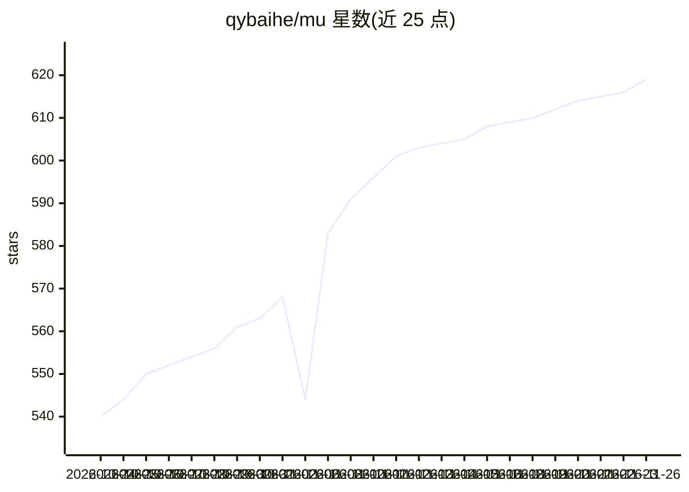

# qybaihe/mu

⭐ 619 · TypeScript · MIT · 推送 2026-11-24 · [GitHub](https://github.com/qybaihe/mu) · [官网](https://usemu.dev) · 组织维护

**给编码 agent 的 41 类判断调用交给小模型，省 token 少打断**

mu 是基于 pi 构建的编码 agent，以 CLI（npm 全局安装 mu-agent）和 macOS/Windows/Linux 桌面应用两种形态提供。核心机制是一个 judge：小型模型在 agent 循环的 41 个决策点上回答是非/选择/评分问题，其中 34 个默认直接执行判定，覆盖输入分类、上下文取舍、工具审批、提示注入筛查、任务漂移检测与子代理委派等。每次判定连同概率与时延写入本地 ledger，任何决策点可设为 shadow 模式只记录不干预。判官模型可替换（本地 mude、HuggingFace 模型、自有服务器或任意 LLM）。

## 筛选速览

| 维度 | 判定 | 备注 |
|---|---|---|
| AI 角色 | `ai-native` | 本体是模型或模型工具 |
| 许可风险 | `permissive` | MIT |
| 部署形态 | `library` | 以包/库形式分发 |
| 模型依赖 | local-ok | 支持本地模型 |
| 硬件要求 | — | 无带数字的原话,不猜 |
| 安装摩擦 | `medium` | 含编译或系统依赖之一 |
| 成熟度 | — | 结构信号不足 |

## 能力要点

- 41 个决策点由 judge 小模型判定，34 个默认自动执行
- 长工具输出分块准入与无损折叠测试日志，降低上下文成本
- 网页与 MCP 输出的提示注入逐段筛查
- 判定写入本地 ledger，支持 shadow 模式对比判官

## 适用场景

- 减少编码 agent 每步弹窗审批的打扰
- 压缩测试日志等长输出进入上下文的 token 开销
- 拦截中途停止或未经验证就声称完成的 agent 运行
- 在 agent 循环中筛查针对 AI 的注入指令

## 场景标签

`编码 Agent` · 领域:编码与开发

## 证据(README 行号)

> L4:  Most of what a coding agent decides isn't code. It's yes/no calls, and mu hands 41 kinds of them to a small model. 
> L27: Asking the main model each of these costs tokens and its attention, and fixed rules get them wrong too often. mu as
> L29: mu comes as a command-line tool, `mu`, which does everything pi does and adds the judgment kernel, and as a desktop

## 星数曲线

2026-10-24 540 → 2026-11-26 619（+79）

---
*卡片 v1 · prompt 1.4 · 生成 2026-11-26 · 置信度 mid · 依据 README sha `69b2f77ad9a3` · [字段定义](../../DATASET.md)*
