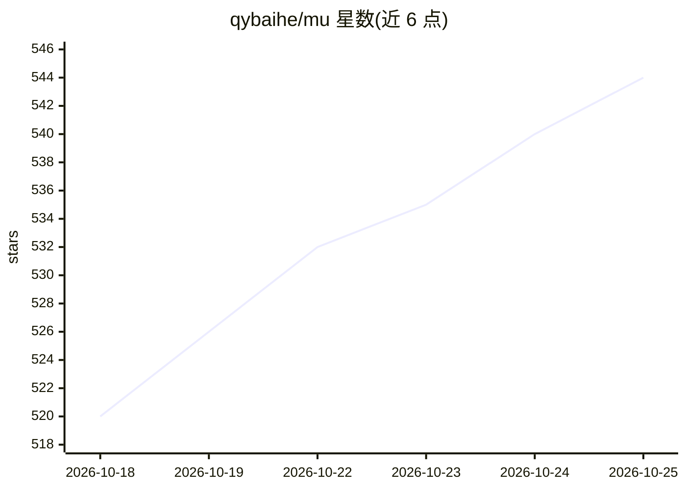

# qybaihe/mu

⭐ 544 · TypeScript · MIT · 推送 2026-10-24 · [GitHub](https://github.com/qybaihe/mu) · [官网](https://usemu.dev) · 个人维护 · 中文 README

**带小模型判断核的编码 agent，让主模型专注写代码**

面向开发者的编码代理，提供 CLI（mu）与桌面应用两种形态。核心机制是在 agent 循环的 40 个决策点引入一个小而快的 judge 模型（默认托管的 Jev，可换本地 Laya 或任意 LLM），代主模型处理上下文准入、工具审批、提示注入筛查、任务漂移检测等非编码决策，裁决记录进本地 ledger，决策点可设 shadow 模式对比。桌面版捆绑运行时，粘贴 API key 或用 ChatGPT/Claude/Grok/Google 订阅登录。自述处于早期开发（0.1.x）。

## 筛选速览

| 维度 | 判定 | 备注 |
|---|---|---|
| AI 角色 | `ai-native` | 本体是模型或模型工具 |
| 许可风险 | `permissive` | MIT |
| 部署形态 | `library` | 以包/库形式分发 |
| 模型依赖 | — | README 未给出锁定关系 |
| 硬件要求 | — | 无带数字的原话,不猜 |
| 安装摩擦 | `low` | 无编译、无系统依赖或容器化 |
| 成熟度 | `idea` | |

## 能力要点

- 40 个决策点的小模型判断核（默认 Jev，本地 Laya 可接管除审批外的点）
- 逐块判断长工具输出、无损折叠重复测试日志（长失败日志实测减 51% 字符）
- 提示注入逐段筛查（网页/搜索结果/MCP 输出）与 MCP 工具描述审查
- 裁决本地 ledger 审计与 shadow 模式对比 judge

## 适用场景

- 日常编码会话中让 agent 自动处理工具审批与上下文取舍
- 对比不同 judge 在各决策点的裁决后再切换
- 通过桌面应用或 CLI 以对话方式完成多步骤编码任务

## 场景标签

`编码 Agent` · 领域:编码与开发

## 证据(README 行号)

> L20: A coding agent makes hundreds of decisions per session that aren't about the code: what goes into the context, whet
> L22: mu comes as a command-line tool, `mu`, which does everything pi does and adds the judgment kernel, and as a desktop

## 星数曲线

2026-10-18 520 → 2026-10-25 544（+24）

---
*卡片 v1 · prompt 1.4 · 生成 2026-10-21 · 置信度 high · 依据 README sha `1b811543bfdf` · [字段定义](../../DATASET.md)*
