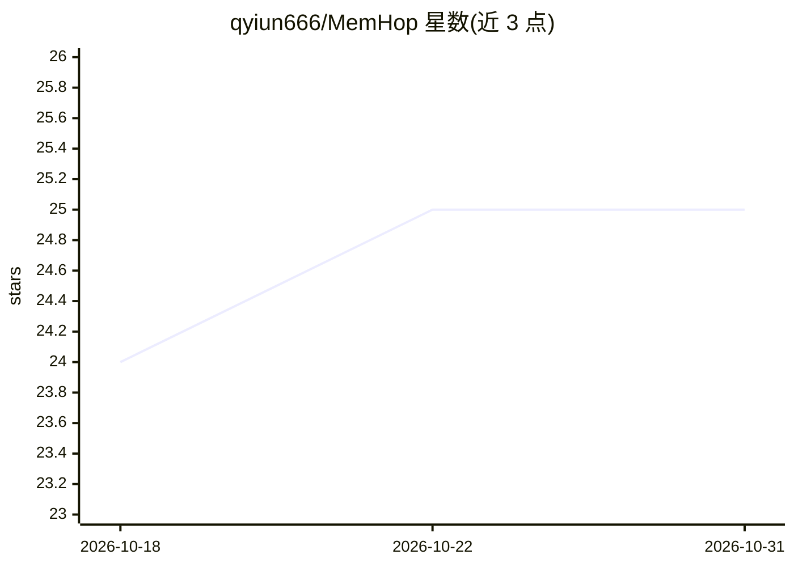

# qyiun666/MemHop

⭐ 25 · Go · Apache-2.0 · 推送 2026-09-30 · [GitHub](https://github.com/qyiun666/MemHop) · 个人维护 · 中文 README

**面向 AI agent 的嵌入式长期记忆数据库（单 .meh 文件）**

用纯 Go 编写的嵌入式长期记忆数据库，供 AI agent 与 LLM 应用以库形式嵌入进程内使用：每个 agent 绑定一个 .meh 文件，文件级独占锁保证单实例，无需服务端。提供六层认知架构（L0 Profile 至 L5 Plan）、知识超图、场景超图、Dream 记忆巩固管线与多 agent 域隔离；检索不依赖 embedding/向量服务，仅要求一个 OpenAI 兼容 LLM 端点。限制：仅打开 FormatVersion=0x0012 文件，旧版无迁移路径。

## 筛选速览

| 维度 | 判定 | 备注 |
|---|---|---|
| AI 角色 | `ai-ecosystem` | LLM/agent 周边工具 |
| 许可风险 | `permissive` | Apache-2.0 |
| 部署形态 | `None` |  |
| 模型依赖 | — | README 未给出锁定关系 |
| 硬件要求 | — | 无带数字的原话,不猜 |
| 安装摩擦 | `low` | 无编译、无系统依赖或容器化 |
| 成熟度 | — | 结构信号不足 |

## 能力要点

- 六层认知架构（L0 Profile → L1 Engram → L2 Context → L3 Knowledge → L4 Archive → L5 Plan）与 Dream 巩固管线
- 单 .meh 嵌入式文件，文件级独占锁，无服务端/后台进程
- 引擎不接入 embedding/向量服务，检索无需向量维度配置
- 多 agent 域隔离共存于一个文件，L3 知识图谱全文件共享

## 适用场景

- 为我的 AI agent 提供跨会话的结构化长期记忆
- 在单文件、零基础设施条件下给 LLM 应用加记忆层
- 多 agent 共享一个知识图谱但记忆相互隔离

## 场景标签

`Agent 记忆` `知识图谱` · 领域:Agent 开发

## 证据(README 行号)

> L18: MemHop is an **embedded long-term memory database for AI agents and LLM applications**, written in pure Go. It is n
> L20: MemHop is an **agent-dedicated** memory database: each agent binds to exactly one `.meh` file, and a file-level exc
> L36: - **Minimal & Embeddable** — 3 direct Go deps (xxhash, go-openai, golang.org/x/sys) — **the engine contacts no embe

## 星数曲线

2026-10-18 24 → 2026-10-31 25（+1）

---
*卡片 v1 · prompt 1.4 · 生成 2026-10-26 · 置信度 high · 依据 README sha `ca75cdb25afd` · [字段定义](../../DATASET.md)*
