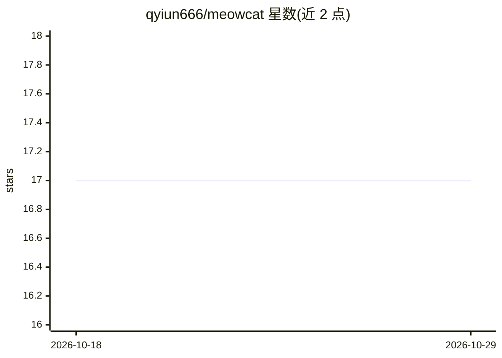

# qyiun666/meowcat

⭐ 17 · Python · MIT · 推送 2026-05-12 · [GitHub](https://github.com/qyiun666/meowcat) · [官网](https://qyiun666.github.io/meowagent.github.io/) · 个人维护 · 中文 README

**仿猫神经系统的 AI agent 框架：定义器官与神经连接构建 agent**

以猫的生物神经系统为蓝图的 Python AI agent 框架：将 agent 建模为 20 个器官（Thalamus 路由、Cerebrum 推理、Amygdala 安全旁路、Hippocampus 记忆等 5 类），通过 Slot-Plug 架构让用户为每个器官提供实现，自带 LLM 的接入由用户以 generate(prompt) 形式插入。提供四层执行模型（Path/Chain/Loop/LoopSequence）、反思式自演化内循环、Colony 多 agent 容器与任务委派。核心零 I/O，v2.0 有破坏性变更，v2.4 起认知模型压缩为 perceive()+ReflectionLoop。

## 筛选速览

| 维度 | 判定 | 备注 |
|---|---|---|
| AI 角色 | `ai-ecosystem` | LLM/agent 周边工具 |
| 许可风险 | `permissive` | MIT |
| 部署形态 | `library` | 以包/库形式分发 |
| 模型依赖 | — | README 未给出锁定关系 |
| 硬件要求 | — | 无带数字的原话,不猜 |
| 安装摩擦 | `low` | 无编译、无系统依赖或容器化 |
| 成熟度 | — | 结构信号不足 |

## 能力要点

- 20 器官 5 类别的仿生蓝图与 Slot-Plug 架构（ALGORITHM|MODEL 两种插件风格）
- Amygdala 安全旁路：检测危险时绕过推理直接输出
- Inner loop 自演化 + Colony 多猫共享存储与角色涌现
- 需自带 LLM，框架不内置任何模型

## 适用场景

- 按生物器官隐喻搭建多组件 AI agent
- 构建带安全旁路与熔断机制的可控 agent 系统
- 在 Colony 中运行多 agent 协作与角色分化实验

## 场景标签

`Agent 框架` `多智能体` · 领域:Agent 开发

## 证据(README 行号)

> L11: An AI agent framework built on a cat's biological blueprint. Define your organs, wire their nerves, and the cat com
> L35: meowcat is to AI agents what a skeleton is to a body — it defines the structure, the connections, the rules of sign
> L138: > 💡 **You need to bring your own LLM.** meowcat doesn't ship with one — provide any `generate(prompt) → str` imple

## 星数曲线

2026-10-18 17 → 2026-10-29 17（+0）

---
*卡片 v1 · prompt 1.4 · 生成 2026-10-29 · 置信度 high · 依据 README sha `b7d5b1eb7c4c` · [字段定义](../../DATASET.md)*
