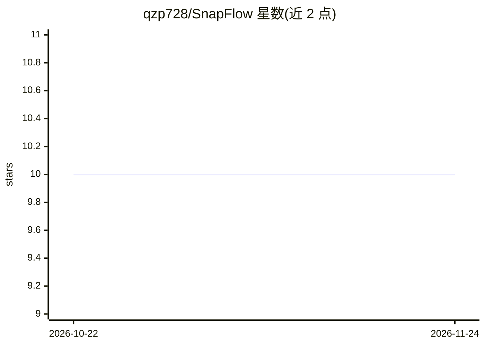

# qzp728/SnapFlow

⭐ 10 · C++ · MIT · 推送 2026-03-20 · [GitHub](https://github.com/qzp728/SnapFlow) · [官网](https://github.com/qzp728/SnapFlow/releases) · 个人维护

**macOS 截图工具：截屏后接 AI 分析、编辑、OCR 翻译**

基于 Qt 6 构建的截图工具，将截图作为工作流起点而非终点。已实现区域截取、基础标注、OCR、翻译浮层、AI 问答与图像分析，支持托盘入口与热键触发。AI 功能通过配置 QWEN_API_KEY 接入；OCR 依赖 tesseract 与 leptonica。目前主要在 macOS 上开发与验证，保留 Qt 基础以支持未来跨平台，交互细节、稳定性与分发仍在完善中。

## 筛选速览

| 维度 | 判定 | 备注 |
|---|---|---|
| AI 角色 | `ai-native` | 本体是模型或模型工具 |
| 许可风险 | `permissive` | MIT |
| 部署形态 | `None` |  |
| 模型依赖 | — | README 未给出锁定关系 |
| 硬件要求 | — | 无带数字的原话,不猜 |
| 安装摩擦 | `medium` | 含编译或系统依赖之一 |
| 成熟度 | `idea` | |

## 能力要点

- 截取区域后直接让 AI 分析仪表盘、图表或 UI 内容
- OCR 与翻译合并为截取→识别→翻译的短路径
- 支持对截取区域进行后续图像编辑（移除元素/遮罩敏感信息）
- 托盘入口与热键触发，macOS 打包脚本含 ad-hoc 签名

## 适用场景

- 截取数据仪表盘后让 AI 解释其中的数据
- 翻译屏幕上的错误提示、设置页或文档片段
- 从截图中移除元素或遮盖敏感信息
- 减少截屏、理解、编辑之间的上下文切换

## 场景标签

`OCR` · 领域:感知与多模态

## 证据(README 行号)

> L11: SnapFlow is an AI-powered screenshot tool built with Qt.
> L64: - Implemented: region capture, basic annotation, OCR, translation overlay, AI Q&A, and image analysis
> L84: Copy `.env.example` to `.env` and provide at least your `QWEN_API_KEY`:

## 星数曲线

2026-10-22 10 → 2026-11-24 10（+0）

---
*卡片 v1 · prompt 1.4 · 生成 2026-11-19 · 置信度 high · 依据 README sha `1af14f059587` · [字段定义](../../DATASET.md)*
