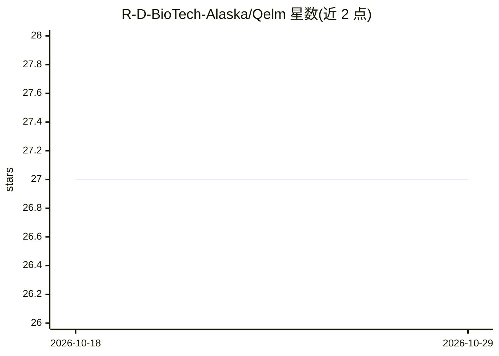

# R-D-BioTech-Alaska/Qelm

⭐ 27 · Python · NOASSERTION · 推送 2026-10-28 · [GitHub](https://github.com/R-D-BioTech-Alaska/Qelm) · [官网](https://www.Qelm.org) · 个人维护

**量子增强生成式语言模型框架：用量子电路做语言建模与训练**

QELM 是围绕可训练量子电路构建的完整语言模型框架，包含 token 嵌入、量子注意力、量子前馈层、子比特编码（幅度+相位双特征）、参数位移梯度与 SPSA 训练、数据集准备工具、`.qelm` 模型格式、训练器 GUI 与轻量聊天界面。后端覆盖 CPU、Qiskit Aer、IBM Quantum 真机、GPU 等实验路径。README 声明项目当前让位于另一项目 Brain，更新待其与 QWEN 3.6 27b 对比后进行。采用 PolyForm Strict 许可，商用需书面许可。面向量计算与 NLP 交叉研究的学习与实验。

## 筛选速览

| 维度 | 判定 | 备注 |
|---|---|---|
| AI 角色 | `ai-native` | 本体是模型或模型工具 |
| 许可风险 | `none` | NOASSERTION |
| 部署形态 | `desktop` | 安装包/桌面程序 |
| 模型依赖 | — | README 未给出锁定关系 |
| 硬件要求 | — | 无带数字的原话,不猜 |
| 安装摩擦 | `low` | 无编译、无系统依赖或容器化 |
| 成熟度 | `idea` | |

## 能力要点

- 量子注意力、量子前馈与量子通道作为架构组成部分
- 子比特编码同时保留幅度与相位两类特征
- 参数位移梯度 / SPSA / Adam 端到端训练，输出 `.qelm` 模型与 token 映射
- 后端路由支持 CPU、Qiskit Aer 本地模拟与 IBM Quantum 真机

## 适用场景

- 学习量子电路在 NLP 中的应用方式
- 在本地或 IBM Quantum 硬件上训练小规模量子语言模型
- 用训练器 GUI 与聊天界面做量子语言建模实验

## 场景标签

`模型训练` · 领域:训练与推理

## 证据(README 行号)

> L27:  QELM is not a classical language model with a small quantum circuit attached to it.
> L44: QELM is a quantum-enhanced generative language-model architecture built to study how quantum-state information can 
> L90: QELM is trained as a language model.

## 星数曲线

2026-10-18 27 → 2026-10-29 27（+0）

---
*卡片 v1 · prompt 1.4 · 生成 2026-10-26 · 置信度 high · 依据 README sha `3984cb83830f` · [字段定义](../../DATASET.md)*
