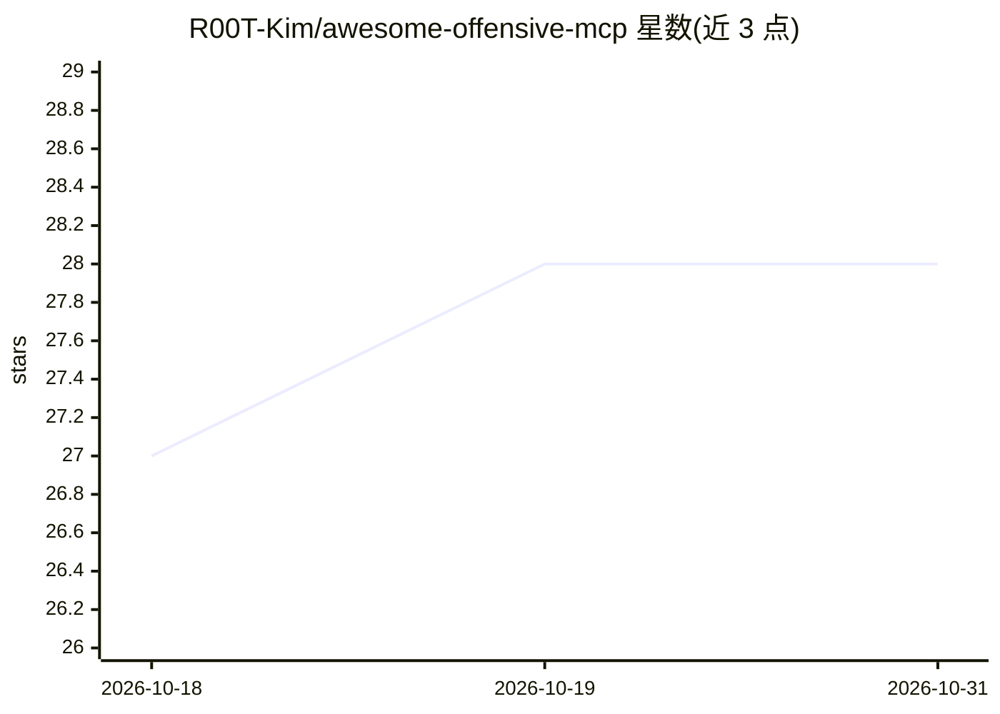

# R00T-Kim/awesome-offensive-mcp

⭐ 28 · NOASSERTION · 推送 2026-05-27 · [GitHub](https://github.com/R00T-Kim/awesome-offensive-mcp) · 个人维护

**红队/渗透测试用 MCP 服务器策展清单**

个人维护的 MCP（Model Context Protocol）服务器策展清单，面向红队、渗透测试与漏洞研究人员，收录经 30+ Stars、亲自验证或官方实现三条准入标准筛选的工具。条目按侦察 OSINT、漏洞研究、Web/网络、武器化利用、密码破解、后渗透与 AD、基础设施等 7 大类组织，覆盖 Nmap、Ghidra、Burp Suite、Metasploit、Hashcat 等工具的 MCP 封装，并声明仅限教育与授权测试用途、建议接入前审计代码。

## 筛选速览

| 维度 | 判定 | 备注 |
|---|---|---|
| AI 角色 | `ai-knowledge` | 知识聚合/清单类 |
| 许可风险 | `none` | NOASSERTION |
| 部署形态 | `None` |  |
| 模型依赖 | — | README 未给出锁定关系 |
| 硬件要求 | — | 无带数字的原话,不猜 |
| 安装摩擦 | `medium` | 含编译或系统依赖之一 |
| 成熟度 | — | 结构信号不足 |

## 能力要点

- 按 7 大攻击阶段类别组织条目
- 准入标准：30+ Stars / 亲自验证 / 官方实现
- 收录官方实现（Semgrep、Redis、MongoDB、Trivy 等）与聚合套件（36+ MCP 桥接 185+ 安全工具）
- 附使用免责声明与接入前代码审计建议

## 适用场景

- 为红队/渗透测试工作流挑选可接入 AI agent 的 MCP 服务器
- 查找逆向分析、AD 攻击路径分析等场景的 MCP 工具封装
- 了解攻击性安全领域的 MCP 生态覆盖范围

## 场景标签

`精选清单` `网络安全` · 领域:学习与行业

## 证据(README 行号)

> L7: > This is a personal collection of **Model Context Protocol (MCP)** servers that I find useful for **Red Teaming, Pe
> L31: ## 📑 Categories

## 星数曲线

2026-10-18 27 → 2026-10-31 28（+1）

---
*卡片 v1 · prompt 1.4 · 生成 2026-10-26 · 置信度 high · 依据 README sha `e2d9f5cac657` · [字段定义](../../DATASET.md)*
