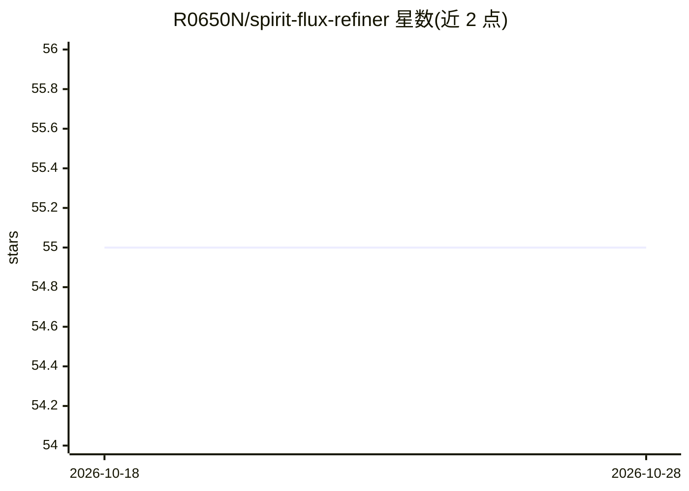

# R0650N/spirit-flux-refiner

⭐ 55 · HTML · 推送 2026-10-27 · [GitHub](https://github.com/R0650N/spirit-flux-refiner) · 个人维护

**面向 Flux1 等模型的 LoRA 训练工作台，供 AI 创作者微调模型**

Spirit-LoRA-Forge 是一个 LoRA 微调训练工具包，前身概念为 spirit-lora-trainer。面向图像生成模型的创作者与研究者，支持 Flux1、SDXL、SD 1.5 等架构的 LoRA 训练。机制包括：自适应学习率调度（APC）、原子化断点保存、数据集预分析与隐式 CLIP 自动打标、将优化器状态卸载至内存/NVMe 以在 12GB 显卡上训练 1024x1024 LoRA、可视化仪表盘（localhost:8080）、REST API 无头模式。产出 .safetensors 文件与训练摘要。提供 ComfyUI 节点包、CivitAI 上传桥接、Discord 监控 bot 等集成，MIT 许可。注意：README 未给出实际安装命令，路线图项目为规划性质。

## 筛选速览

| 维度 | 判定 | 备注 |
|---|---|---|
| AI 角色 | `ai-ecosystem` | LLM/agent 周边工具 |
| 许可风险 | `none` | — |
| 部署形态 | `None` |  |
| 模型依赖 | — | README 未给出锁定关系 |
| 硬件要求 | — | 无带数字的原话,不猜 |
| 安装摩擦 | `medium` | 含编译或系统依赖之一 |
| 成熟度 | `idea` | |

## 能力要点

- APC 动态学习率调度引擎
- 内存卸载机制支持 12GB GPU 训练 1024x1024 LoRA
- 无标注时用 CLIP 模型自动生成标签
- 提供 ComfyUI 节点包与 CivitAI 桥接集成

## 适用场景

- 在消费级显卡上为 Flux1/SDXL 训练风格或角色 LoRA
- 通过交互式向导配置训练并实时监控进度
- 将训练好的 LoRA 一键上传 CivitAI 或接入 ComfyUI 流水线

## 场景标签

`微调` · 领域:训练与推理

## 证据(README 行号)

> L8: Welcome to **Spirit-LoRA-Forge**, an evolutionary leap from the foundational `spirit-lora-trainer` concept. While it
> L22: While optimized for Flux1, the underlying engine is **architecture-agnostic**. It elegantly handles Diffusers, Safe
> L53: Run `spirit-forge run --config my_recipe.yaml`. The Forge will:

## 星数曲线

2026-10-18 55 → 2026-10-28 55（+0）

---
*卡片 v1 · prompt 1.4 · 生成 2026-10-24 · 置信度 mid · 依据 README sha `09c3030e2b70` · [字段定义](../../DATASET.md)*
