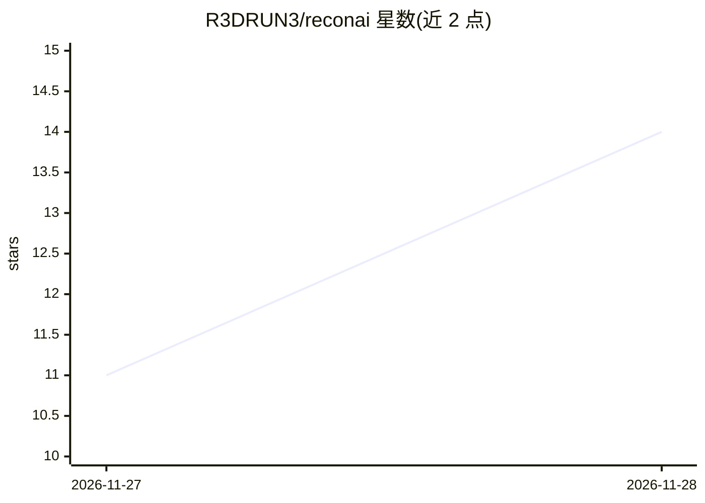

# R3DRUN3/reconai

⭐ 14 · Python · Unlicense · 推送 2026-11-27 · [GitHub](https://github.com/R3DRUN3/reconai) · 个人维护

**给安全团队用 LLM agent 驱动的授权侦察扫描 API 服务**

一个内含 LLM agent 的 Kali 容器，以 REST API 形式提供：POST 提交目标后，agent 按白名单运行 nuclei、gobuster、wpscan、nmap 等非侵入工具，返回 JSON 结果与 Markdown 报告。与给予 LLM shell 的进攻型 agent 框架不同，它只允许清单内工具、单 agent、调用次数受限（默认 30 次）、范围在代码层强制执行，支持批量最多 50 个并发扫描，定位为快速发现低危暴露面的自动化侦察。通过 docker 运行，需配置 OpenAI 兼容 API。

## 筛选速览

| 维度 | 判定 | 备注 |
|---|---|---|
| AI 角色 | `ai-native` | 本体是模型或模型工具 |
| 许可风险 | `permissive` | Unlicense |
| 部署形态 | `self-host` | docker 或自建部署 |
| 模型依赖 | local-ok | 支持本地模型 |
| 硬件要求 | — | 无带数字的原话,不猜 |
| 安装摩擦 | `low` | 无编译、无系统依赖或容器化 |
| 成熟度 | — | 结构信号不足 |

## 能力要点

- 单一 HTTP API 提交扫描并获取 Markdown 报告，支持批量 50 个并发
- 工具白名单与非侵入参数，scope 在代码层强制校验
- 兼容任何支持 tool calling 的 OpenAI 兼容 API（OpenAI、Azure、vLLM、Ollama、LiteLLM）
- 每次扫描输出工具运行的精确命令、状态与输出（tool_runs）

## 适用场景

- 用 cron 或 CI 每晚对自己的域名做边界检查并对比报告
- 新子域名上线后快速查看实际暴露面
- 批量提交域名做程序化轻量扫描

## 场景标签

`网络安全` · 领域:学习与行业

## 证据(README 行号)

> L12: reconai is a small Kali container with an API and an LLM agent inside.
> L13: You POST a target, the agent runs a handful of authorized tools against the target, and you get back a JSON result 
> L46: reconai works with any OpenAI-compatible API that supports tool calling (OpenAI, Azure Foundry, vLLM, Ollama, LiteL

## 星数曲线

2026-11-27 11 → 2026-11-28 14（+3）

---
*卡片 v1 · prompt 1.4 · 生成 2026-11-27 · 置信度 high · 依据 README sha `9320b7036eba` · [字段定义](../../DATASET.md)*
