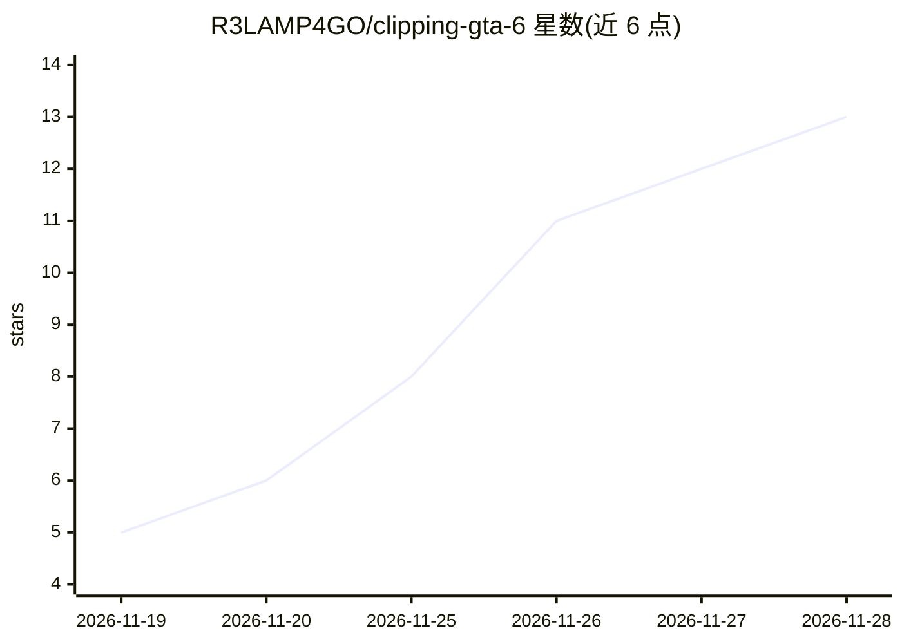

# R3LAMP4GO/clipping-gta-6

⭐ 13 · Python · AGPL-3.0 · 推送 2026-11-26 · [GitHub](https://github.com/R3LAMP4GO/clipping-gta-6) · [官网](https://whop.com/opsyscollective/products) · 个人维护

**让 Claude Code/Codex 实时剪辑 GTA 6 直流成字幕竖屏 Shorts**

在 Claude Code 或 Codex 中运行的 GTA 6 直播/投稿剪辑流水线：以 30 分钟分段边直播边录制 Twitch/Kick/YouTube，按音量突增、欢呼、最重播数据等信号定位剪辑时刻，生成多类钩子文案并依据 3,481 条真实游戏 Shorts 数据排名，每个钩子渲染一条带字幕的 9:16 MP4。支持 Fish Audio 同声配音多语言、Demucs 人声分离、按 niche 组织 profile、定时无人值守运行与磁盘清理。仅支持 macOS/Linux 本地运行，配音与说话人分离部分依赖外部 API 或 macOS。

## 筛选速览

| 维度 | 判定 | 备注 |
|---|---|---|
| AI 角色 | `ai-native` | 本体是模型或模型工具 |
| 许可风险 | `viral` | AGPL-3.0 |
| 部署形态 | `None` |  |
| 模型依赖 | locked-api |  |
| 硬件要求 | — | 无带数字的原话,不猜 |
| 安装摩擦 | `medium` | 含编译或系统依赖之一 |
| 成熟度 | — | 结构信号不足 |

## 能力要点

- 直播进行中即录制，分块约 2 小时内完成剪辑
- 钩子文案按 3,481 条游戏 Shorts 实测数据排名，`clipper check` 拦截弱钩子
- Fish Audio 克隆主播本人声音的多语言配音，逐句保留音高响度与情绪提示
- 提供 /clip、/clip-daily、/clip-schedule 等 Agent 命令与 python3 -m clipper CLI

## 适用场景

- 直播还在进行时就把 GTA 6 名场面剪成可发布的 Shorts
- 同一素材生成多条不同钩子的视频做 A/B 测试
- 用定时任务每天无人值守剪辑关注的创作者
- 把剪辑配音成西语/俄语等其他语言发布

## 场景标签

`图像视频处理` · 领域:感知与多模态

## 证据(README 行号)

> L16: GTA Clipper turns GTA 6 streams and uploads into ready-to-post vertical Shorts. You run it from Claude Code or Code
> L30: - **Runs inside your AI agent.** Claude Code or Codex does the judgment calls (which moment, which hook, which layo

## 星数曲线

2026-11-19 5 → 2026-11-28 13（+8）

---
*卡片 v1 · prompt 1.4 · 生成 2026-11-20 · 置信度 high · 依据 README sha `f1a04285bfd2` · [字段定义](../../DATASET.md)*
