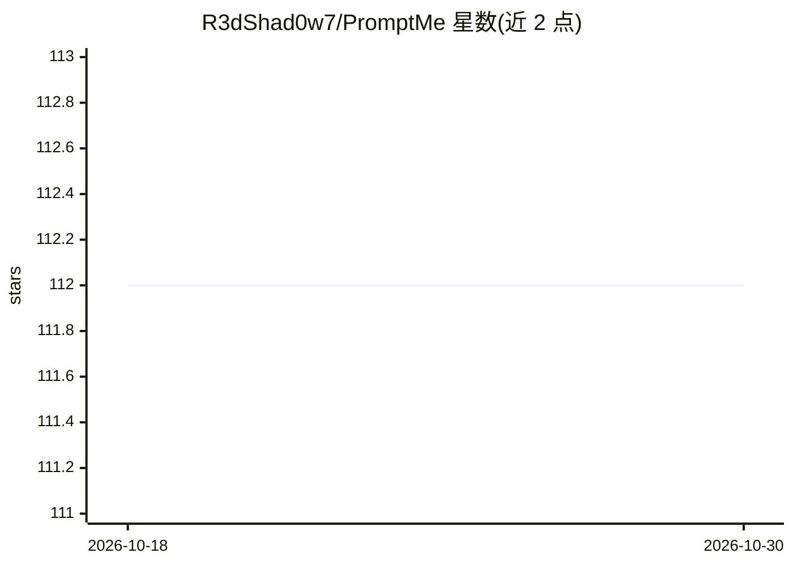

# R3dShad0w7/PromptMe

⭐ 112 · Python · Apache-2.0 · 推送 2026-09-10 · [GitHub](https://github.com/R3dShad0w7/PromptMe) · 个人维护

**故意含漏洞的 LLM 应用：以 CTF 挑战演示 OWASP LLM Top 10**

面向 AI 安全从业者的教育项目：一个故意植入安全漏洞的 LLM Web 应用，包含基于 OWASP LLM Top 10 的 10 个 CTF 式动手挑战，每个挑战有目标、可选提示与通关 flag，并附解答（Spoilers）供初学者理解漏洞代码。基于 Python 与 Ollama 框架配合开源模型（mistral、llama3、sqlcoder、granite 系列等）本地运行，无需 API key。当前支持 macOS 与 Linux，Windows 兼容在开发中；官方建议在虚拟或沙箱环境运行。

## 筛选速览

| 维度 | 判定 | 备注 |
|---|---|---|
| AI 角色 | `ai-knowledge` | 知识聚合/清单类 |
| 许可风险 | `permissive` | Apache-2.0 |
| 部署形态 | `self-host` | docker 或自建部署 |
| 模型依赖 | local-ok | 支持本地模型 |
| 硬件要求 | — | 无带数字的原话,不猜 |
| 安装摩擦 | `low` | 无编译、无系统依赖或容器化 |
| 成熟度 | — | 结构信号不足 |

## 能力要点

- 10 个基于 OWASP LLM Top 10 的 CTF 式挑战（目标+提示+flag）
- 基于 Python 与 Ollama 本地运行，无需 API key
- 提供挑战解答（Spoilers）帮助初学者理解漏洞代码
- 附带 Discord 社区支持与 MIT 许可证

## 适用场景

- 安全从业者学习 LLM 应用漏洞的发现与利用方式
- 团队开展 LLM 安全红队训练与 CTF 演练
- 了解 prompt 注入等 LLM Top 10 风险的缓解策略

## 场景标签

`网络安全` `教程课程` · 领域:学习与行业

## 证据(README 行号)

> L7: PromptMe is an educational project that showcases security vulnerabilities in large language models (LLMs) and their
> L9: This project is intended for AI Security professionals to explore potential security risks in LLMs and learn effecti

## 星数曲线

2026-10-18 112 → 2026-10-30 112（+0）

---
*卡片 v1 · prompt 1.4 · 生成 2026-10-23 · 置信度 mid · 依据 README sha `7363e859ce7e` · [字段定义](../../DATASET.md)*
