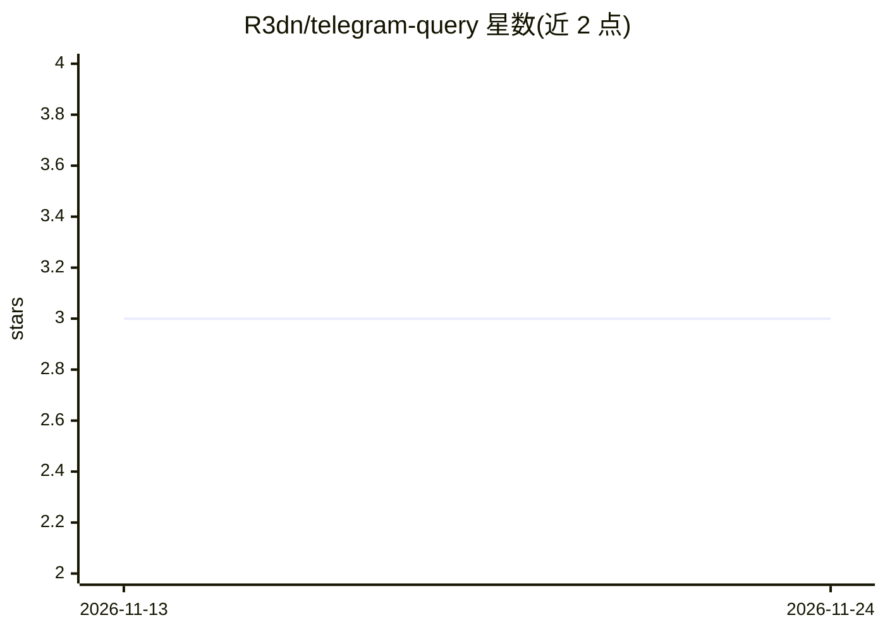

# R3dn/telegram-query

⭐ 3 · Python · MIT · 推送 2026-11-12 · [GitHub](https://github.com/R3dn/telegram-query) · 个人维护

**本地优先的 Telegram 群组存档：可搜索、可 AI 问答**

连接用户 Telegram 账号，跟踪指定群组并在本地建立可搜索的消息知识库：提供趋势话题发现、按日分隔的历史浏览、阿拉伯语与英语全文检索，以及仅基于自身消息作答、带可点击引用的 Ask-AI 面板。全部数据、数据库与 Telegram 会话留在本机，服务器仅绑定 127.0.0.1；提问时仅将检索到的摘要发送到用户配置的 OpenAI 兼容端点。Windows 提供安装包，开发模式需 Python 3.10+。

## 筛选速览

| 维度 | 判定 | 备注 |
|---|---|---|
| AI 角色 | `ai-native` | 本体是模型或模型工具 |
| 许可风险 | `permissive` | MIT |
| 部署形态 | `desktop` | 安装包/桌面程序 |
| 模型依赖 | — | README 未给出锁定关系 |
| 硬件要求 | — | 无带数字的原话,不猜 |
| 安装摩擦 | `low` | 无编译、无系统依赖或容器化 |
| 成熟度 | — | 结构信号不足 |

## 能力要点

- 阿拉伯语/英语全文检索与方言词映射配置
- Ask-AI 仅从本地消息作答，每条 [n] 引用可跳转原消息
- AI 模型/端点/密钥/每日请求上限均可通过环境变量配置
- Discover 视图的趋势与统计为确定性计算，无需 AI

## 适用场景

- 把关注的 Telegram 群组沉淀为可检索的私人知识库
- 用自然语言查询群组历史并获得带引用的回答
- 本地化存档群组消息以保障隐私

## 场景标签

`文档问答` · 领域:知识与检索

## 证据(README 行号)

> L10: filters, run full-text searches across Arabic and English, and ask questions
> L11: answered *only* from your actual messages — with clickable citations back to
> L52: > **Privacy note:** asking a question sends only the excerpts it retrieves
> L69: |`AI_BASE_URL`|OpenAI|Any OpenAI-compatible endpoint|

## 星数曲线

2026-11-13 3 → 2026-11-24 3（+0）

---
*卡片 v1 · prompt 1.4 · 生成 2026-11-22 · 置信度 high · 依据 README sha `4aecbb87363a` · [字段定义](../../DATASET.md)*
