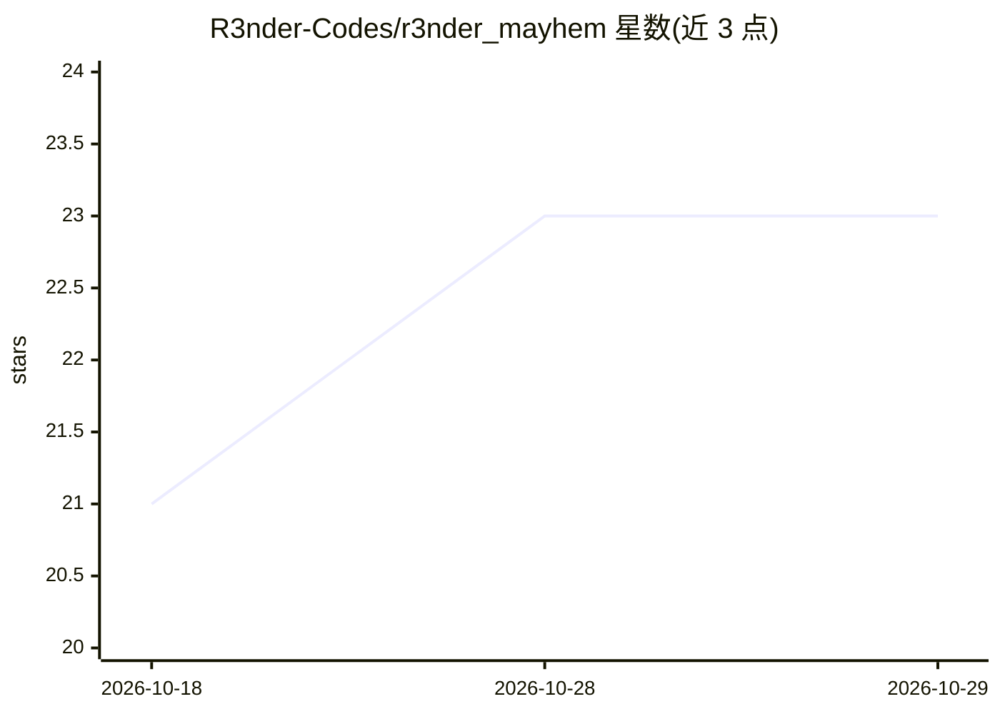

# R3nder-Codes/r3nder_mayhem

⭐ 23 · Shell · GPL-3.0 · 推送 2026-03-07 · [GitHub](https://github.com/R3nder-Codes/r3nder_mayhem) · 个人维护

**HackRF PortaPack 的自制 RF 应用合集（信标欺骗、检测、干扰等）**

面向 HackRF One + PortaPack H1/H2 与 Mayhem 固件的自定义应用集合，包含 9 个 RF 工具：RF 信标轮换欺骗测试、FM 频段音乐发射、被动信号尖峰检测（RF 运动感知）、短促干扰、GPS L1 欺骗包发送、2.4GHz 低分辨率移动检测、13.56MHz RFID 读取器干扰、数据包中继与屏幕 RF 监视器。项目自称教育与实验用途。安装需 CMake、ARM GCC 工具链并自行编译固件，依赖 MicroSD 卡刷写。

## 筛选速览

| 维度 | 判定 | 备注 |
|---|---|---|
| AI 角色 | `ai-native` | 本体是模型或模型工具 |
| 许可风险 | `viral` | GPL-3.0 |
| 部署形态 | `None` |  |
| 模型依赖 | — | README 未给出锁定关系 |
| 硬件要求 | — | 无带数字的原话,不猜 |
| 安装摩擦 | `medium` | 含编译或系统依赖之一 |
| 成熟度 | `idea` | |

## 能力要点

- 9 个 PortaPack 自定义应用，覆盖欺骗、检测、干扰、中继
- 被动信号尖峰检测（Trigger Radar）与 2.4GHz 移动检测
- 依赖 Mayhem 固件，通过 git clone + install.sh + make 编译

## 适用场景

- 在 PortaPack 上做 RF 信号实验与教学演示
- 测试信标/GPS/RFID 系统对欺骗与干扰的耐受性
- 被动感知环境中的 RF 运动信号

## 场景标签

`网络安全` · 领域:学习与行业

## 证据(README 行号)

> L12: |Trigger Radar|Passive signal spike detection (RF motion)|
> L15: |Microwave Presence|Low-res movement detection via 2.4GHz|

## 星数曲线

2026-10-18 21 → 2026-10-29 23（+2）

---
*卡片 v1 · prompt 1.4 · 生成 2026-10-28 · 置信度 mid · 依据 README sha `9b8556adf284` · [字段定义](../../DATASET.md)*
