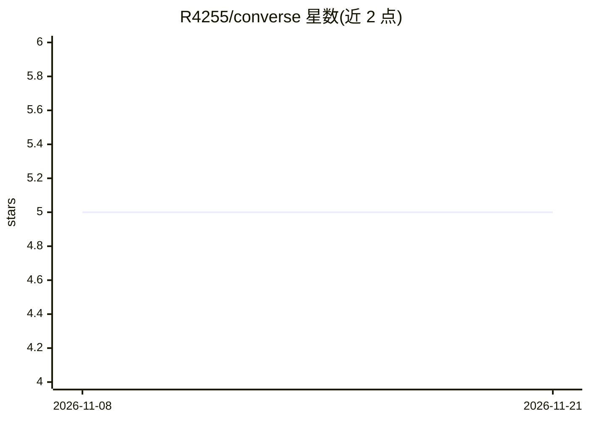

# R4255/converse

⭐ 5 · Python · 推送 2026-10-23 · [GitHub](https://github.com/R4255/converse) · 个人维护

**本地 LLM agent 驱动杂货应用 UI 的 AI 命令层**

为一个杂货应用构建的单输入框 AI 命令层：本地 LLM agent 通过工具调用搜索商品、填充购物车并导航 UI，工具返回类型化 ui_actions 由 React 前端经 SSE 执行。技术栈含 Ollama 运行的开源模型（7B 与 LoRA 微调的 1.5B）、Postgres+pgvector 混合检索（RRF）、FastAPI 后端、LocalStack 模拟的 SQS/S3/EventBridge。附 130 任务结果断言评测集与安全确认门（下单需用户点击确认）。局限：合成目录数据、单机本地运行、模型权重未入库。

## 筛选速览

| 维度 | 判定 | 备注 |
|---|---|---|
| AI 角色 | `ai-native` | 本体是模型或模型工具 |
| 许可风险 | `none` | — |
| 部署形态 | `None` |  |
| 模型依赖 | local-ok | 支持本地模型 |
| 硬件要求 | — | 无带数字的原话,不猜 |
| 安装摩擦 | `low` | 无编译、无系统依赖或容器化 |
| 成熟度 | — | 结构信号不足 |

## 能力要点

- 130 任务/143 轮的结果断言评测集，任务成功率 74.4%→93.1%
- LoRA 微调 1.5B 模型（MLX 训练、导出 GGUF、app 端提示渲染避免 train/serve skew）
- BM25+pgvector 密集检索的 RRF 混合，可加 cross-encoder 重排
- 结构性安全机制：一次性确认令牌、防提示注入评测、不可逆操作须确认

## 适用场景

- 在本地用自然语言完成购物应用的搜索、下单、导航操作
- 参考其评测方法构建基于端状态断言的 agent 评测
- 学习小模型 LoRA 微调与训练/服务格式对齐实践
- 通过 MCP 服务器把同一套工具暴露给桌面 AI 客户端

## 场景标签

`模型评测` `RAG` `微调` · 领域:评测与运维

## 证据(README 行号)

> L1: # Converse: an AI command layer for a grocery app
> L8: Everything runs locally: open models on Ollama (a 7B, plus a **1.5B I fine-tuned with LoRA to match a 3B**),
> L107: * **The agent drives the UI.** Tools return typed `ui_actions` (`navigate`, `show_products`, `confirm`,

## 星数曲线

2026-11-08 5 → 2026-11-21 5（+0）

---
*卡片 v1 · prompt 1.4 · 生成 2026-11-21 · 置信度 high · 依据 README sha `34a2e927a96c` · [字段定义](../../DATASET.md)*
