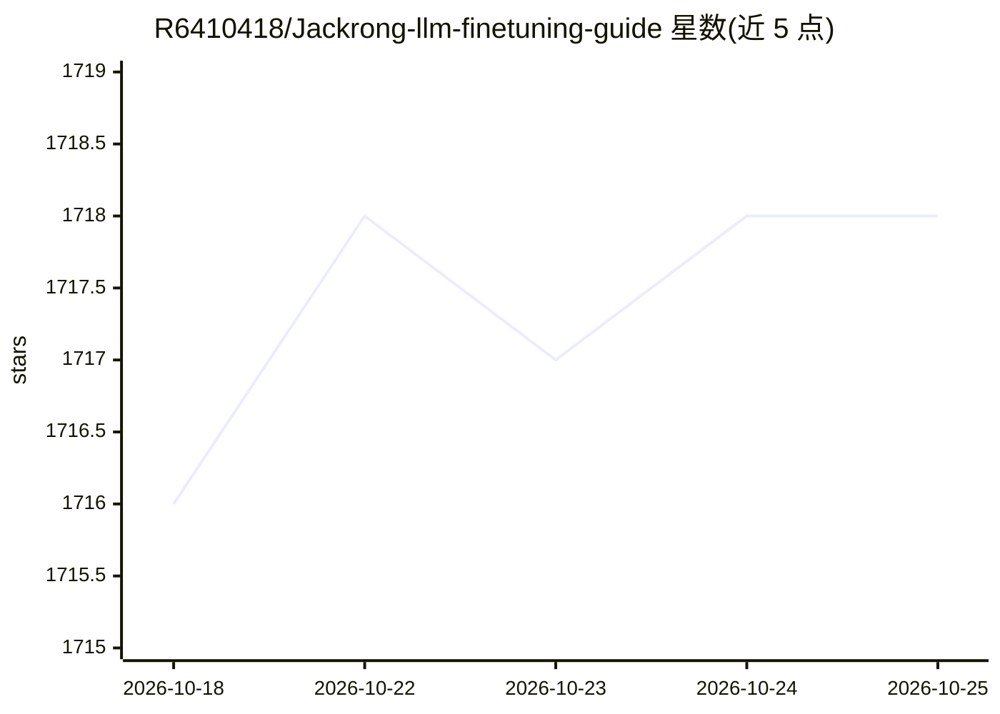

# R6410418/Jackrong-llm-finetuning-guide

⭐ 1,719 · Jupyter Notebook · Apache-2.0 · 推送 2026-07-11 · [GitHub](https://github.com/R6410418/Jackrong-llm-finetuning-guide) · [官网](https://r6410418.github.io/Jackrong-llm-finetuning-guide/) · 个人维护 · 中文 README

**面向初学者的 LLM 微调教学知识库：教程+数据集+工具**

教育性质的开源知识库，面向初学者与开发者，提供可复现的训练流水线：SFT 与 GRPO/GSPO 强化学习教程、数据处理与蒸馏方法、24 个精选数据集（含批量下载脚本）、16 位导出与 GGUF 部署流程，以及将 Qwen 系模型转换为 MTP GGUF 的子项目（预检、张量注入、llama.cpp 转换、量化、上传）。训练环境以 Google Colab 和 Kaggle 为主，配套长篇 PDF 指南与中/韩/日多语言文档。

## 筛选速览

| 维度 | 判定 | 备注 |
|---|---|---|
| AI 角色 | `ai-knowledge` | 知识聚合/清单类 |
| 许可风险 | `permissive` | Apache-2.0 |
| 部署形态 | `None` |  |
| 模型依赖 | local-ok | 支持本地模型 |
| 硬件要求 | — | 无带数字的原话,不猜 |
| 安装摩擦 | `low` | 无编译、无系统依赖或容器化 |
| 成熟度 | — | 结构信号不足 |

## 能力要点

- SFT/LoRA/QLoRA 与 GRPO/GSPO 强化学习训练配方，运行于 Colab/Kaggle
- 24 个精选高保真数据集及 download_datasets.py 批量下载
- Qwen MTP GGUF 转换技能：预检、张量注入、llama.cpp 转换、量化、上传
- 面向多模型族（Qwen/Llama3.2-R1 等）的路线图与多语言文档

## 适用场景

- 在浏览器里完成第一个 LLM 微调实验
- 为训练准备或蒸馏高质量数据集
- 将 Qwen 模型转换为 MTP GGUF 并量化部署

## 场景标签

`教程课程` `微调` `强化学习` · 领域:学习与行业

## 证据(README 行号)

> L3: An educational, end-to-end open-source knowledge base for LLM fine-tuning,
> L19: This repository is a growing educational resource portal for beginners and developers who want reproducible trainin
> L41: |🏋️ Training Recipes|SFT, GRPO, and GSPO notebooks and Python tutorials|Open|

## 星数曲线

2026-10-18 1,716 → 2026-10-25 1,718（+2）

---
*卡片 v1 · prompt 1.4 · 生成 2026-10-21 · 置信度 high · 依据 README sha `d80061bca27b` · [字段定义](../../DATASET.md)*
