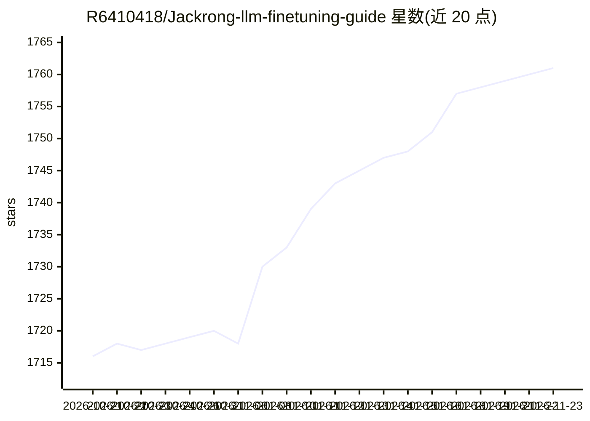

# R6410418/Jackrong-llm-finetuning-guide

⭐ 1,761 · Jupyter Notebook · Apache-2.0 · 推送 2026-11-16 · [GitHub](https://github.com/R6410418/Jackrong-llm-finetuning-guide) · [官网](https://r6410418.github.io/Jackrong-llm-finetuning-guide/) · 个人维护 · 中文 README

**开源语言模型微调教程知识库：SFT/RL/蒸馏/本地部署**

面向初次尝试微调的学习者的教程合集，以笔记本和脚本形式逐篇走完环境配置、数据准备、训练与导出部署流程。收录 SFT、LoRA/PEFT、GRPO 等奖励式训练及蒸馏配方，覆盖 Qwen、Llama 等模型在 Colab/Kaggle/Python 环境的运行方式，并附模型发布记录、数据集目录与 MTP GGUF 转换工具。Apache-2.0 许可，提供中英韩日多语言文档。

## 筛选速览

| 维度 | 判定 | 备注 |
|---|---|---|
| AI 角色 | `ai-knowledge` | 知识聚合/清单类 |
| 许可风险 | `permissive` | Apache-2.0 |
| 部署形态 | `None` |  |
| 模型依赖 | — | README 未给出锁定关系 |
| 硬件要求 | — | 无带数字的原话,不猜 |
| 安装摩擦 | `low` | 无编译、无系统依赖或容器化 |
| 成熟度 | — | 结构信号不足 |

## 能力要点

- 6 个训练配方覆盖 SFT、LoRA、GRPO、蒸馏方法
- Colab/Kaggle 一键打开的笔记本与 Python 脚本
- 附带推理数据集目录与下载工具、MTP GGUF 转换流水线
- 中/英/韩/日多语言文档

## 适用场景

- 我第一次微调开源 LLM，想照着笔记本逐步跑通
- 我想在 Colab 或 Kaggle 免费环境里练 LoRA 训练
- 我需要把推理记录整理成数据集做冷启动训练

## 场景标签

`教程课程` `微调` `强化学习` · 领域:学习与行业

## 证据(README 行号)

> L3: A practical guide to distillation, supervised and reward-based training, and local deployment for open language mode
> L20: Each guide follows the published notebook or script through setup, data, training, and export.
> L66:   title = {Jackrong LLM Fine-Tuning Guide: An Educational LLM Fine-Tuning Knowledge Base},

## 星数曲线

2026-10-21 1,716 → 2026-11-23 1,761（+45）

---
*卡片 v1 · prompt 1.4 · 生成 2026-11-23 · 置信度 high · 依据 README sha `94f84faee335` · [字段定义](../../DATASET.md)*
